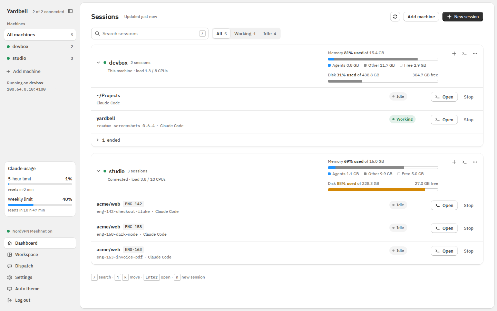
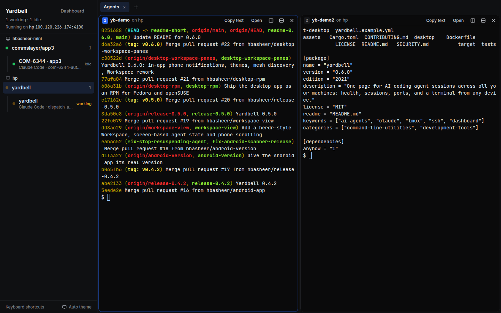
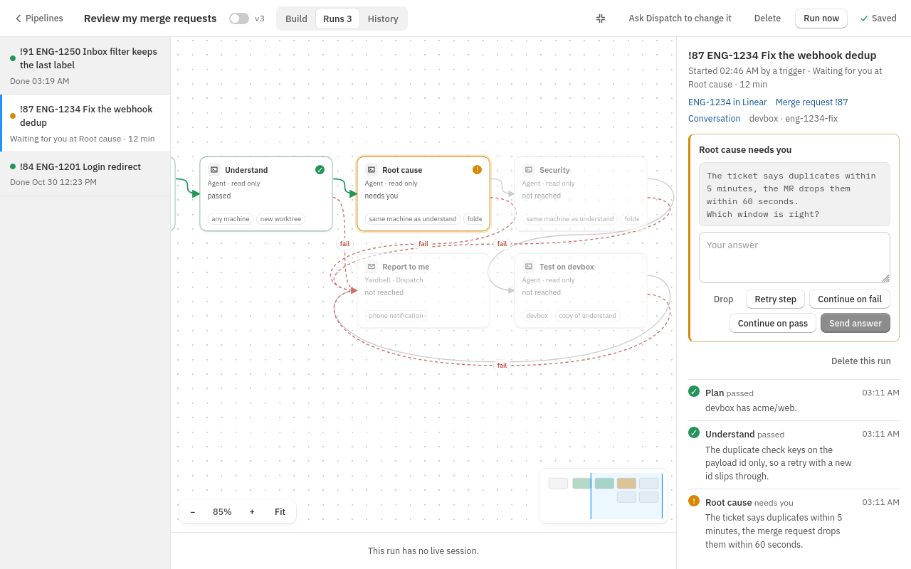

# Yardbell

**One page for every AI coding agent session across all your machines.**

Yardbell runs on one machine and watches the others over ssh. It shows which machines are up and how
much memory and disk they have left, which agent session (Claude Code, Codex, Gemini CLI, opencode,
Aider and more) runs where and for which ticket, and which local port opens the app each session is
working on. It opens a full terminal into any session from your desktop or your phone, and puts
several side by side in a Workspace. It can also do the work for you: Dispatch starts agents from a
sentence, and pipelines carry a ticket or a merge request through steps you define and stop only
when they need you. Nothing is installed on the machines it manages: it is one Rust binary with a
plain HTML UI, plus apps for macOS, Linux and Android.



## Features

- **Machine health first.** Connection state with the reason when something fails, memory drawn to
  scale with the agents' share, CPU load, disk use and mesh VPN status.
- **Every agent session.** Ten agents out of the box and any CLI agent you add. Folder, ticket,
  branch, and whether the agent is working, idle or waiting for you, read from its own screen.
- **A terminal anywhere.** Any tmux session in the browser, the desktop app or the phone, with
  scrollback, a key row on phones, and the screen you use setting the session's size.
- **Workspace.** Every terminal in one sidebar by machine and folder, with tabs and split panes,
  and Dispatch in a panel beside them.
- **New sessions where you want them.** Pick a machine, one of its installed agents, a folder and a
  branch; other branches get their own git worktree.
- **Ports, already tunnelled.** Docker Compose ports from each session's folder, forwarded to the
  host with live status.
- **Pipelines.** Steps you draw on a canvas, from a trigger (by hand, a schedule, a Linear ticket, a
  connected tool like Trello, a webhook, or a review request on GitHub or GitLab) to a report. A run uses one agent session, plus a read-only
  one for reviews, shows its live terminal, and waits for you only when it must.
- **Dispatch.** Describe a task and Yardbell picks the machine with the repository and the most room,
  then starts an agent there. It can also read and change Yardbell itself, and build and run
  pipelines, with your rules deciding what waits for you. It sits beside your terminals in the
  Workspace, and hides with one click.
- **Connections.** Sign in to Trello, Jira and other tools from your browser, with no token to paste, or
  connect any MCP server by its address. Trello can start pipeline runs, and a **Use a connected tool** step
  does one action in any connected tool with no agent. A tool with no MCP server connects with a token, and a token
  you paste is saved as a secret by itself.
- **Proposals.** Changes asked for by other MCP clients, such as Claude Code with Yardbell added, wait
  in one inbox until you approve, edit or reject them.
- **GitHub and GitLab.** Each session shows its branch's pull or merge request with its state and CI, through local `gh` or `glab`, or a token.
  Settings says which service each of your folders uses and whether `gh` and each GitLab token work.
- **Phone notifications.** The Android app says when an agent waits for you, a session ends, a
  machine goes down, memory runs low, a pipeline needs you or finishes, or a proposal waits, with no
  other app to install.
- **Add machines from the UI.** Mesh peers, ssh key setup, `~/.ssh/config`, tool checks and a folder
  picker, without editing a file.
- **Mesh VPN aware.** NordVPN Meshnet, Tailscale, Headscale, NetBird and ZeroTier, and the apps
  find the servers on it so signing in takes only the passcode.
- **An MCP server for agents.** Agents can list machines and sessions, start, read and answer them,
  and read every part of Yardbell. Secrets are never shown.
- **One menu on every page.** Dashboard, Workspace, Pipelines, Dispatch, Proposals and Settings in
  the same place everywhere, as a tab bar along the bottom on a phone.
- **Light or dark, and small to run.** A theme button in every sidebar; about 9 MB of memory, a
  service in one command and a `doctor` that checks everything.



## How a pipeline works



1. **Something starts a run:** **Run now**, a schedule, a Linear ticket assigned to you, an item in a
   connected tool, a webhook, or a review request. **Plan** can pick the machine, folder and branch for it.
2. **The steps share one session.** An agent works in one worktree, and each step's task is typed into
   the same session when the agent is idle, so a run holds far less memory than one session per step.
3. **A review gets its own session.** A step marked as a review starts a read-only agent that cannot
   edit files and did not write the code. A step on another machine or with another agent gets its
   own session too.
4. **Each step ends with a result:** pass, fail or needs you. You draw where each one goes, so a failed
   review can loop back to a fix.
5. **The run waits only when it must,** such as when an agent asks something, a rule refuses a step or
   a step hits its limit. Your phone says so and the run page shows what to do.
6. **When the run ends,** every session stops and the worktree and branch stay. A teardown command,
   such as `docker compose down`, can clear what the worktree started.

Two templates are ready to copy: **Implement my tickets** and **Review my merge requests**.
[Pipelines](docs/automation.md#pipelines) explains every step and setting.

## Download

Get the file for your system from the
[latest release](https://github.com/hbasheer/yardbell/releases/latest):

| System | File |
|---|---|
| macOS, Apple silicon and Intel | `Yardbell_<version>_universal.dmg` |
| Linux | `Yardbell_<version>_amd64.AppImage` |
| Debian and Ubuntu | `Yardbell_<version>_amd64.deb` |
| Fedora and openSUSE | `Yardbell-<version>-1.x86_64.rpm` |
| Android 7 and later | `Yardbell_<version>_android.apk` |

The desktop app can run the Yardbell server itself (**Run one on this machine**) or connect to one
that is already running. The Android app pairs by scanning a code from **Settings → Connect a phone**.
On an iPhone, open the dashboard in the browser. Install steps for each system are in
[the apps](docs/apps.md).

## Quick start

```sh
git clone https://github.com/hbasheer/yardbell && cd yardbell
cargo build --release
install -m 755 target/release/yardbell ~/.local/bin/yardbell

mkdir -p ~/.config/yardbell
cp yardbell.example.yml ~/.config/yardbell/yardbell.yml
$EDITOR ~/.config/yardbell/yardbell.yml     # describe the host as the `local: true` machine

yardbell passcode                        # set the login passcode
yardbell                                 # start, then open http://localhost:4000
yardbell doctor                          # check config, VPN, every machine
yardbell install-agent                   # optional: start at login
```

Then add the other machines from **Add machine** in the UI, or list them in `yardbell.yml`. The
[configuration guide](docs/configuration.md) explains every setting.

## Documentation

- [The apps](docs/apps.md): the desktop app, the Android app and phone notifications.
- [Using Yardbell](docs/usage.md): dashboard, new sessions, Workspace, the terminal, adding
  machines, Settings, Pipelines, Dispatch and Proposals.
- [AI agents and MCP](docs/agents.md): the agents Yardbell knows, adding your own, and its MCP
  server.
- [Running Yardbell](docs/running.md): how it works, requirements, mesh VPNs, ports, commands,
  Docker and security.
- [Triggers, worktree setup, rules, pipelines and connectors](docs/automation.md): start Dispatch
  tasks on a schedule or for new tickets, prepare and clear each worktree, decide what Dispatch may
  do, build pipelines, and connect outside tools, with examples.
- [Configuration](docs/configuration.md): every setting in `yardbell.yml`.
- [Troubleshooting](docs/troubleshooting.md) and [Development](docs/development.md).

## License

[MIT](LICENSE)
