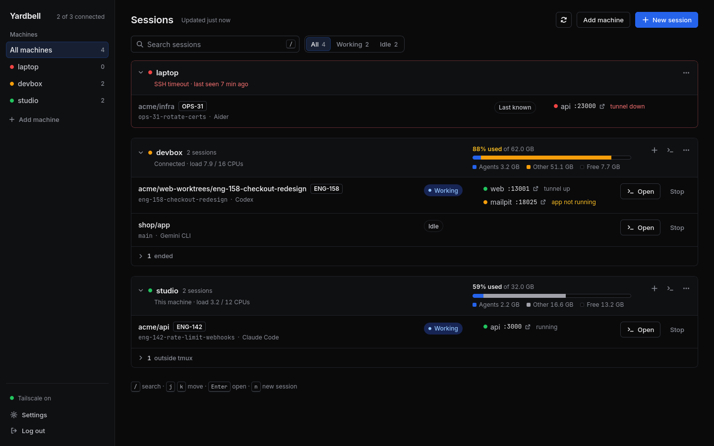

# Yardbell

**One page for every AI coding agent session across all your machines.**

Yardbell runs on one machine and watches the others over ssh. It shows which machines are up and how
much memory they have left, which agent session (Claude Code, Codex, Gemini CLI, opencode, Aider and
more) runs where and for which ticket, and which
local port opens the app each session is working on. It opens a full terminal into any session
from your desktop or your phone, creates a git worktree per branch, and adds new machines without
hand-editing ssh config.

Nothing is installed on the machines it manages. It is one Rust binary with a plain HTML UI, and a
[desktop app](#apps) for macOS and Linux adds a tray icon and a notification when an agent needs you.



## Why

If you spread work across a desktop, a laptop and a Linux box (usually because Docker stacks and
several agent sessions eat all the RAM on one machine), you lose track quickly:

- Is that machine even connected right now, and does it have memory to spare?
- Which terminal tab is the session for ENG-142, and on which machine?
- Which port do I open to test that branch?
- How do I check on a long-running session from my phone?

Yardbell answers all of these on one page.

## Features

- **Machine health first.** Connection state (mesh, ssh, snapshot) with the reason when something
  fails, memory drawn to scale with the agents' own share, CPU load, and mesh VPN status.
- **Every agent session.** Claude Code, Codex, Gemini CLI, Qwen Code, opencode, Copilot CLI,
  Cursor Agent, Crush, Goose and Aider out of the box, and any other CLI agent you add in the config.
  Machine, agent, folder, ticket (read from the branch name), branch, working or idle, and whether
  it can be opened. Sessions on unreachable machines stay visible as
  "last known".
- **Ports, already tunnelled.** Docker Compose service ports from each session's folder are forwarded
  to the host over ssh (`prefix * 10000 + port`), with live status: tunnel up, app not running,
  tunnel down.
- **A real terminal anywhere.** Open any tmux session in the browser with xterm.js, from the desktop
  or a phone (with an Esc, Tab, Ctrl and arrow key row). Closing the tab only detaches.
- **A desktop app.** For macOS and Linux: the dashboard and every terminal as tabs in a window of
  their own, with the system clipboard, every machine's state in the tray, and a notification when
  an agent is waiting, a session ends, a machine goes down or memory runs out.
- **Phone notifications.** Through the free ntfy app, the server itself tells your phone when an
  agent is waiting for you, a session ends, a machine goes down or memory runs low, with no browser
  tab or desktop app open.
- **New sessions where you want them.** Pick the agent, browse any folder on any machine, pick the current branch,
  another branch or a new one. Other branches get their own git worktree, so several sessions can
  work on one repo at once.
- **Add machines from the UI.** Lists peers from your mesh VPN, checks reachability, sets up ssh key
  login (you type the password once in a browser terminal), writes the `~/.ssh/config` entry with a
  backup, and checks that tmux, git and docker are installed and which agents are.
- **Mesh VPN aware.** NordVPN Meshnet, Tailscale, Headscale, NetBird and ZeroTier: status, peer
  lists, a Turn on button, and clear reasons when the VPN is the problem.
- **A relay that picks the machine.** Describe a task in the Relay chat. It finds the machines that
  have the repository, picks the one with the most free memory and the least load, and starts an
  agent there with your task.
- **An MCP server for agents.** Claude Code and other MCP clients can list machines and sessions,
  start sessions, read them and answer them. Sessions can also get your other MCP servers (GitHub,
  Linear and so on) when they start.
- **Settings without YAML.** Switch VPN provider with an address mapping step, edit machines, change
  the passcode, log out every other device, and undo the last change.
- **Small and boring to run.** About 9 MB of memory, a launchd or systemd service in one command, a
  `doctor` command that checks everything, and a Docker image for Linux hosts.

## How it works

```
                 your phone / tablet / laptop (browser or desktop app, on the mesh VPN)
                                         │
                                         ▼
┌──────────────── host (runs yardbell) ───────────────────────────┐
│  web UI :4000  ·  poller  ·  ssh tunnels  ·  pty for terminals  │
└───────┬──────────────────────────┬──────────────────────────────┘
        │ ssh (one shared           │ ssh -L (one tunnel per
        │ connection per machine)   │ machine for app ports)
        ▼                           ▼
   devbox, laptop, ...  tmux sessions running agents, git checkouts, docker compose
```

Every few seconds Yardbell pipes a small read-only shell script (`src/snapshot.sh`) over ssh to each
machine. It reports agent processes and their folders, tmux sessions, git branches, Docker Compose
ports, memory, load and mesh addresses as JSON. Everything Yardbell changes on another machine is
limited to `tmux new`, `tmux kill-session` and `git worktree add`.

## Requirements

- **Host** (where Yardbell runs): macOS or Linux, Rust stable to build, `ssh`.
- **Managed machines:** `sshd`, `tmux`, `git`, at least one AI coding agent, and optionally Docker Compose for port
  forwarding. Any bash works, including the macOS default bash 3.2.
- **Network:** every machine reachable over ssh from the host, usually through a mesh VPN. Only port
  22 needs to be open on managed machines.

## Quick start

```sh
git clone https://github.com/hbasheer/yardbell && cd yardbell
cargo build --release
install -m 755 target/release/yardbell ~/.local/bin/yardbell

mkdir -p ~/.config/yardbell
cp yardbell.example.yml ~/.config/yardbell/yardbell.yml
$EDITOR ~/.config/yardbell/yardbell.yml     # describe the host as the `local: true` machine

yardbell passcode                        # set the login passcode
yardbell                                 # start, then open http://localhost:4000
yardbell doctor                          # check config, VPN, every machine
yardbell install-agent                   # optional: start at login
```

Then add the other machines from **Add machine** in the UI, or list them in `yardbell.yml`. The
[configuration guide](docs/configuration.md) explains every setting.

### Docker (Linux hosts)

```sh
UID=$(id -u) GID=$(id -g) docker compose -f docker-compose.example.yml up -d --build
docker compose -f docker-compose.example.yml run --rm yardbell passcode
```

The container runs as your user so ssh accepts the mounted `~/.ssh`, and uses host networking so
tunnels and the mesh address work. Inside Docker, Yardbell cannot see the host's own processes: leave
out `local: true`, add the host like any other machine (it needs sshd), and set `listen_ip` to the
host's mesh address. Docker on macOS is unverified, see
[docs/docker-on-macos.md](docs/docker-on-macos.md); use the native binary on macOS.

## Apps

The desktop app for macOS and Linux opens the dashboard in a window of its own, shows the state of
every machine in the tray, and sends system notifications, so Yardbell does not need a browser
tab. It connects to a Yardbell that is already running (see [Quick start](#quick-start)), or, on a
machine with no server yet, **Run one on this machine** sets one up and runs it inside the app for as
long as the app runs. The app needs a server from
the same release: an older server answers the app's sign-in with a 404, and the app then reports
that it can't reach the server. To build that release, run `git checkout v<version>` in your clone
before `cargo build --release`.

Download the file for your system from the
[latest release](https://github.com/hbasheer/yardbell/releases/latest):

| System | File |
|---|---|
| macOS, Apple silicon and Intel | `Yardbell_<version>_universal.dmg` |
| Linux | `Yardbell_<version>_amd64.AppImage` |
| Debian and Ubuntu | `Yardbell_<version>_amd64.deb` |

- **macOS.** Open the `.dmg` and drag Yardbell to Applications. The app is not notarized by
  Apple, so macOS blocks the first launch. On macOS 14 and earlier, right-click Yardbell in
  Applications, choose **Open**, then **Open** again. On macOS 15 and later, open it once, then go
  to System Settings, Privacy & Security, and press **Open Anyway**. If macOS says the app is
  damaged, run `xattr -dr com.apple.quarantine /Applications/Yardbell.app` once.
- **Linux.** Run `chmod +x Yardbell_*.AppImage` and start the file, or on Debian and Ubuntu
  install the `.deb` with `sudo apt install ./Yardbell_<version>_amd64.deb`. Arch and Omarchy
  need `webkit2gtk-4.1` (`sudo pacman -S webkit2gtk-4.1`).
- **Phones and Windows.** There is no app for Android, iPhone or Windows yet. On a phone, open the
  dashboard in the browser, see [Terminal and phone](#terminal-and-phone).

There is no auto-update. To upgrade, install the newer release over the old one.

**First run.** The app asks for the server address and the passcode you set with
`yardbell passcode`. Type the address you use in a browser, for example `100.64.0.12:4000`;
`http://` is added when you leave it out. The app signs in and keeps the session in the system
keychain (the macOS Keychain, or the Secret Service on Linux, such as GNOME Keyring or KWallet).
The passcode itself is not stored. Later launches go straight to the dashboard, and when the server
ends the session the app asks for the passcode again.

**Tabs.** The window has a tab bar: the first tab is the dashboard, and every terminal you open
(from the dashboard or from a notification) is a tab after it. A tab shows the session's folder and
machine, and a terminal you open twice reuses its tab. Close a terminal tab with its cross, a
middle click or the keys below. The tab keys work in the dashboard and in a terminal:

| Action | macOS | Linux |
|---|---|---|
| Go to tab 1 to 8 (1 is the dashboard) | `⌘1` to `⌘8` | `Ctrl+1` to `Ctrl+8` |
| Go to the last tab | `⌘9` | `Ctrl+9` |
| Next tab | `Ctrl+Tab` | `Ctrl+Tab` |
| Previous tab | `Ctrl+Shift+Tab` | `Ctrl+Shift+Tab` |

Closing is in the shortcuts table below.

**Tray.** On Linux the icon is the Yardbell mark in green when every machine is up, amber when a
machine is at 85% memory or more, red when a machine is down and gray when the server cannot be
reached. On macOS the menu bar shows
the logo's mark in the menu bar's color, with a dot when a machine is down or memory is high,
faded when not connected. A left click there opens a panel with every machine's memory and CPU
(the 1-minute load per core) and the sessions you can open; its gear holds the notification
switches, Start at login, Disconnect and Quit. A right click opens the
menu. On Linux the panel draws the menu, so it opens however that panel opens tray menus
(a right click on Waybar, any click with GNOME's AppIndicator extension). The menu lists each machine
under **Machines** with a state dot, a memory bar and its memory and CPU use (click one to see it in
the dashboard), then every
session you can open under **Sessions**, named like its tab, with **working** after the ones whose
agent is busy. Click a session to bring the window forward on its tab. Past 15 sessions,
**All sessions…** opens the dashboard. After that come **Open Yardbell**, **New session**, **Notifications**, **Start at
login**, **Disconnect** (forgets the session and shows the sign-in again) and **Quit**. Closing the
window only hides it: the app keeps running in the tray until you choose **Quit**. On Linux the
tray needs a desktop with tray support; GNOME needs the AppIndicator extension, which Ubuntu turns
on by default.

**Notifications.** The app checks the server every 5 seconds and shows a system notification when:

- an agent finished or is waiting for you (it has been idle for 20 seconds),
- a session ended,
- a machine went down (it has been unreachable for a minute) or came back,
- a machine's memory passed 95%.

Each kind has a switch under **Notifications** in the tray menu. All four are on by default and the
choice is kept between launches. These switches are for the desktop app on that computer; phone
notifications have their own in Settings. Click an agent notification to open that session's terminal.
Notifications that stay in the macOS Notification Center or in GNOME's list keep their click
routing. Once 8 of them are waiting, newer ones show without an **Open** button until older ones
are cleared.

**Clipboard and shortcuts.** Terminal tabs use the system clipboard directly, so copy and paste
work without the `https` limit described under [Terminal and phone](#terminal-and-phone).

| | Linux | macOS |
|---|---|---|
| Copy the selection | `Ctrl+Shift+C` | `Cmd+C` |
| Paste | `Ctrl+Shift+V` | `Cmd+V` |
| Close a terminal tab | `Ctrl+Shift+W` | `Cmd+W` |
| Quit | `Ctrl+Shift+Q` | `Cmd+Q` |
| New session (dashboard tab) | `Ctrl+N` | `Cmd+N` |

Plain `Ctrl+C`, `Ctrl+W` and the other control keys still go to the shell and the agent, except
`Ctrl+1` to `Ctrl+9` and `Ctrl+Tab`, which switch tabs. In the dashboard tab, `Ctrl+W` hides the
window and `Ctrl+Q` quits.

## Phone notifications

Yardbell can tell your phone when an agent is waiting for you, a session ends, a machine goes down
or comes back, or a machine's memory reaches 95%. The server sends them itself through
[ntfy](https://ntfy.sh), a free app that shows whatever is posted to a topic, so no browser tab or
desktop app has to be open. Tap a waiting agent's notification to open that session's terminal in
the phone's browser, or any other one to open the dashboard, behind the usual login.

1. On the Settings page, press **Set up** under **Phone notifications**. Yardbell makes a topic
   named `yardbell-` and 24 random letters and digits.
2. Install ntfy on your phone from Google Play, F-Droid or the App Store.
3. On Android, open the Settings page on your phone and tap **Subscribe in ntfy**. On an iPhone, or
   to do it by hand, press **Copy** next to the topic and subscribe to that topic in the ntfy app.
   With your own ntfy server, enter its address in the app too. The page shows it under the topic.
4. Press **Send a test notification**. The page says **Sent**, or shows the error.

**The wait.** An agent counts as waiting once it has been idle for 20 seconds after working.
Yardbell then holds the notification for 2 minutes and only sends it if the agent is still
waiting, so nothing arrives when you answer it in time. Change the minutes next to
**Agent waiting**, or set 0 to be told right away. The other kinds are sent at once. Each kind has
its own switch, and a saved change applies on the next check.

The section also shows when the last notification went out, or why the last attempt failed. A
notification that fails is tried once more after 5 seconds and then dropped. Nothing is queued for
later. **Turn off** forgets the topic, so setting up again makes a new one that the phone has to
subscribe to again (**Undo** right after Turn off brings the old topic back).

**What the ntfy server sees.** Notifications carry machine, folder and agent names, memory figures,
and the link a tap opens, which holds Yardbell's mesh address and tmux session names. They never
carry passcodes, cookies or terminal content. Anyone who knows the topic can read the
notifications, so treat it like a password. Yardbell shows it only on the Settings page.

**Limits.** The free tier of ntfy.sh has a daily message limit. Past it, ntfy.sh refuses new
messages, and the Settings page shows its answer as the last error.

**Your own ntfy server.** Open **Advanced**, enter its address as **ntfy server**, add an
**Access token** if your topic needs one, and press **Save** before you subscribe on the phone:
the Subscribe link and the server address the page shows come from the saved setting. An `https`
server needs a certificate from a public authority, because Yardbell trusts only the public root
certificates it ships with. On the mesh, an `http://` address works too. For the iPhone app, the
ntfy server also needs `upstream-base-url: "https://ntfy.sh"` in its own config, or notifications
can take hours to arrive.

The settings live under `phone_notifications` in `yardbell.yml`, see the
[configuration guide](docs/configuration.md#phone_notifications-optional).

## Using Yardbell

### Dashboard

The page is grouped by machine. Each machine gets a section: its health on top (connection, load,
memory drawn to scale with the agents' share in blue, amber from 85% and red from 95%), its sessions
below. The sidebar lists the machines, problems first, with a session count; click one to show only
that machine.

- **Top bar:** search sessions by folder, branch, ticket or agent (press `/`), show All, Working or
  Idle sessions, **Refresh** to check every machine right away, Add machine and New session.
- **Machine header:** fold the section away, **+** starts a new session on that machine, the terminal
  button opens a plain shell there (no agent, in its own tmux session), and the **⋯** menu has
  Machine settings, Copy ssh command and Remove machine.
- **Sessions** show folder, ticket, branch, agent, status and ports. Click a row (or press `Enter`) to
  open its terminal, use `j` and `k` to move, and `n` to start a new session.

Sessions started outside tmux, and sessions that ended, fold into the footer of their machine's
section, since Yardbell can see them but cannot attach to them. Open the list and press **Move to
tmux** on one: Yardbell stops that agent (it asks first) and starts it again in tmux with its resume
command, so the conversation continues, then opens its terminal. The terminal it ran in before gets
its prompt back.

### New session


1. Pick a machine and an agent. The agent you used last is preselected.
2. Pick a folder from **Recent** or browse the machine. Git repositories show their branch.
3. For a git repository, stay on the current branch, pick another branch, or create a new one from
   a base. Any branch other than the current one opens in its own worktree at
   `<repo>-worktrees/<branch>`; an existing worktree for that branch is reused.

The footer always says where the session will start. Yardbell starts the agent inside a new tmux
session through your login shell, so your PATH and environment apply, then opens its terminal.
**Continue the last conversation** and **Resume** on an ended session use the agent's own resume
command, listed below.

## AI agents

Yardbell finds sessions by process name and starts them with the agent's own command. These work
without any config:

| Agent | Starts with | Resumes with | Free option |
|---|---|---|---|
| Claude Code | `claude` | `claude --continue` | |
| Codex | `codex` | `codex resume --last` | |
| Gemini CLI | `gemini` | `gemini --resume` | free tier with a Google account |
| Qwen Code | `qwen` | `qwen --continue` | free tier with a Qwen account |
| opencode | `opencode` | `opencode --continue` | free models, or your own key |
| Copilot CLI | `copilot` | `copilot --continue` | free GitHub Copilot plan |
| Cursor Agent | `cursor-agent` | `cursor-agent resume` | |
| Crush | `crush` | `crush --continue` | your own key or a local model |
| Goose | `goose session` | `goose session --resume` | your own key or a local model |
| Aider | `aider` | `aider --restore-chat-history` | your own key or a local model |

Free tiers and plans change, so check each agent's site. Agents that take your own key also work
with local models through Ollama or LM Studio at no cost.

Add any other CLI agent, or change the commands of a built-in one, under `agents:` in the config:

```yaml
default_agent: codex              # preselected in New session the first time
agents:
  - name: amp                     # [a-z0-9-]+
    label: Amp                    # shown in the UI (optional)
    command: amp
    resume: amp threads continue
  - name: codex                   # same name as a built-in: replaces its commands
    command: codex --full-auto
    resume: codex resume --last --full-auto
  - name: my-agent
    command: npx my-agent
    resume: npx my-agent --continue
    process: my-agent             # process name to look for, when it differs from the command
```

Ended sessions resume with the agent they ran. Memory used by every agent process counts toward the
blue share of the memory bar.

### Terminal and phone


Turn on the mesh VPN on your phone and open `http://<host-mesh-ip>:4000`. Everything works the same,
including the terminal. Several devices can attach to one session; the window follows whichever
device typed last.

On a phone the machines stay on top, sessions become cards, and the terminal gets a key row for Esc,
Tab, Ctrl, the arrows and Ctrl-C. Yardbell follows the system light or dark setting on every device.

<br clear="right">

**Copying from the terminal.**

- **Drag to select.** With tmux mouse mode on (`set -g mouse on`), tmux makes the selection and
  sends it to your clipboard when you let go. Yardbell asks tmux to do this for its terminal.
- **Shift-drag** (Option-drag on a Mac) selects in the browser instead, and copies when you let go.
- **Copy text** in the header shows the screen as plain text. Select any part of it, or press
  **Copy all**. On a phone, this is the way to copy.

Browsers only allow automatic clipboard access on `https` pages or `localhost`. Over
`http://<host-mesh-ip>` Yardbell copies straight away when it can. If the browser blocks it, a
**Copy** button appears for a few seconds; tap it to finish copying.

### Add machine


Pick a peer from your mesh (phones and tablets are hidden) or type an IP or hostname, then enter the
username and a short name. Yardbell checks each step and stops with the reason when one fails:
reachable, ssh key login, the `~/.ssh/config` entry (shown before it is written, backed up first,
never overwriting an existing `Host`), installed tools, and the project folder.

### Settings


- **Mesh VPN:** choose a provider and press **Check addresses**. Yardbell reads the new VPN's peer list
  and proposes each machine's new address. **Switch VPN** saves `yardbell.yml` and updates the matching
  `HostName` lines in `~/.ssh/config`, with backups of both. If the host's own address changes,
  restart Yardbell (a button does it when Yardbell runs as a service).
- **Machines:** edit ssh host, mesh address, port prefix, project folder and VPN override, or remove
  a machine.
- **Phone notifications:** set up, test and adjust notifications to your phone, see
  [Phone notifications](#phone-notifications).
- **Security:** change the passcode (takes effect immediately) and log out every other device.
- **Undo** restores the previous `yardbell.yml` and `~/.ssh/config` after any change.

### Relay

The **Relay** page takes a task in plain words, like "fix the flaky webhook test in commslayer on a
new branch com-1234-webhook-flake". It runs Claude Code on the host (`claude -p`) with only
Yardbell's own tools, so it can look at machines, folders and sessions and start, read and answer
sessions, but cannot change files itself. It picks a machine that is up and has the repository,
preferring the most free memory, the lowest load and the fewest running agents, then starts the
default agent there with your task and links to the new session's terminal. Follow-up messages
continue the same conversation, for example "what is that session doing now?" or "tell it yes".
Claude Code must be installed and signed in on the host.

## Agent tools (MCP)

Turn on **Agent tools (MCP)** in Settings to let any MCP client use Yardbell. Settings shows the
command for Claude Code, for example:

```sh
claude mcp add --transport http --scope user yardbell http://100.64.0.10:4000/mcp \
  --header "Authorization: Bearer yb_..."
```

| Tool | What it does |
|---|---|
| `list_machines` | up or down and why, memory total and free, agents' share, load, CPUs, session count |
| `list_sessions` | agent, folder, ticket, branch, working or idle, tmux name |
| `list_folders` | git checkouts per machine with their branch, and recent folders |
| `start_session` | start an agent in a folder, on a branch (new ones get a worktree), with a task |
| `read_session` | what the session's terminal shows, with scrollback |
| `send_to_session` | type a reply and press Enter |
| `stop_session` | end the session |

**MCP servers for sessions** in Settings lists other MCP servers (a command such as
`npx -y @modelcontextprotocol/server-github`, or a URL) and the machines they are for. Claude Code
sessions that Yardbell starts get them through `--mcp-config`, so nothing is written on the
machines. Other agents configure MCP their own way and do not get them.

## Mesh VPN support

Set `mesh` in `yardbell.yml` or on the Settings page. A machine can override it with its own `mesh:`.

| Provider | Status | Peers for Add machine | Turn on |
|---|---|---|---|
| `nordvpn` (Linux CLI) | `nordvpn settings` | `nordvpn meshnet peer list` | `nordvpn set meshnet on` |
| `nordvpn` (macOS app) | mesh address on an interface | type the IP from the app | open the app |
| `tailscale`, `headscale` | `tailscale status --json` | same | `tailscale up` |
| `netbird` | `netbird status --json` | same | `netbird up` |
| `zerotier` | `zerotier-cli info` | type the IP from ZeroTier Central | `zerotier-cli join` yourself |
| `none` | mesh address on an interface | type the IP | |

Turn on only works on the host: a remote machine whose VPN is off cannot be reached to fix it.

## Ports

A session's app port on a remote machine opens on the host at `port_prefix * 10000 + port`. With
`port_prefix: 1`, port `3001` on that machine is `localhost:13001` on the host, or
`<host-mesh-ip>:13001` from a phone. Ports of 10000 and above are not forwarded. Which Docker
Compose services are forwarded is set by `forward_services`.

Ports of apps running on the host itself are not tunnelled. They open at their own port, for
example `<host-mesh-ip>:3100` from a phone. On a Linux host with a firewall, other devices can
only reach them if the firewall lets mesh traffic through to Docker (see
[Troubleshooting](#troubleshooting)).

## Configuration

`~/.config/yardbell/yardbell.yml` (or `--config <path>`, or `YARDBELL_CONFIG`). **Start with the
step-by-step guide: [docs/configuration.md](docs/configuration.md)**. It covers first setup, how to
find each value (mesh addresses, Docker service names, ticket patterns), what applies without a
restart, validation errors and common setups. A commented example is
[yardbell.example.yml](yardbell.example.yml).

Quick reference:

| Key | Meaning |
|---|---|
| `port` | Web UI port on the host (default 4000) |
| `poll_seconds` | How often every machine is checked (default 5) |
| `host_terminal` | `iterm2`, `terminal` or `none`: the "Terminal app" button on a macOS host |
| `mesh` | Mesh VPN provider, see above |
| `ticket_pattern` | Regex that finds a ticket id in branch names; empty disables tickets |
| `forward_services` | Docker Compose service names whose ports are tunnelled |
| `workspaces` | Folder globs under each machine's root that hold git checkouts |
| `default_agent` | Agent preselected in New session (default `claude`) |
| `agents` | Extra agents, or changed commands for built-in ones, see [AI agents](#ai-agents) |
| `phone_notifications` | Notifications to your phone through ntfy, see [Phone notifications](#phone-notifications); keys in the [configuration guide](docs/configuration.md#phone_notifications-optional) |
| `listen_ip` | Address to listen on besides 127.0.0.1; defaults to the local machine's `mesh_ip` |
| `machines[].name` | Short name, `[a-z0-9-]+` |
| `machines[].local` | `true` for the machine Yardbell runs on (native mode only) |
| `machines[].ssh` | ssh host alias (defaults to the name) |
| `machines[].mesh_ip` | Address on the mesh VPN |
| `machines[].port_prefix` | 1 to 6, unique; required for remote machines |
| `machines[].root` | Project folder on that machine |
| `machines[].workspaces`, `machines[].mesh` | Per-machine overrides |

`passcode_hash`, `cookie_key` and `recent` folders are written by Yardbell itself.

## Commands

```
yardbell [serve] [--no-open]   start the web UI (the default)
yardbell passcode              set or change the login passcode
yardbell doctor                check config, passcode, mesh VPN, every machine, sleep and firewall
yardbell install-agent         start at login (launchd on macOS, systemd user unit on Linux)
yardbell uninstall-agent       remove that service
yardbell --version
```

## Security

Anyone who logs in to Yardbell gets a full shell on every machine it manages. Treat the passcode like an
ssh key.

- Yardbell listens only on `127.0.0.1` and the host's mesh address, never on all interfaces.
- Every page, API call and terminal websocket requires the login cookie (signed, `HttpOnly`,
  `SameSite=Strict`, 30 days). Five wrong passcodes in a minute lock that address out for five
  minutes.
- Requests that change anything must come from Yardbell's own page (Origin check). The one
  exception is `/mcp`, which takes a bearer token instead of the cookie and still turns away any
  request whose Origin is another site.
- The MCP token can start and type into sessions on every machine, like a login. It is off until
  you turn it on in Settings, and making a new one stops the old one at once. The relay uses its own
  token, made fresh each time Yardbell starts and never written to disk.
- The desktop app signs its window in with a one-time code. Making a code needs a login, and the code
  works once, within 30 seconds. The window's login ends when the app quits; the app keeps its own
  login in the system keychain.
- Input that reaches a shell, ssh or `~/.ssh/config` (hostnames, usernames, branch names) is
  validated first, and every value passed to a shell is quoted.
- Do not put Yardbell on the public internet.

See [SECURITY.md](SECURITY.md) to report a vulnerability.

## Making every session openable

Yardbell can only open sessions that run inside tmux. Sessions you start from Yardbell always do, and
**Move to tmux** brings one that doesn't over. To make
sessions you start in a terminal openable too, add this to your shell config on each machine. List
the agents you use:

```sh
for agent in claude codex gemini opencode aider; do
  eval "$agent() {
    if [ -n \"\$TMUX\" ]; then command $agent \"\$@\"; return; fi
    tmux new -A -s \"\$(basename \"\$PWD\" | tr . -)\" \"command $agent \$*\"
  }"
done
```

## Troubleshooting

Start with `yardbell doctor`. Common cases:

- **A machine shows "SSH refused" or "Host key verification failed".** Yardbell uses ssh in batch mode
  and never answers prompts. Run `ssh <host> true` once from the host to accept the key, or use Add
  machine, which opens a terminal for that.
- **"Not on the mesh (VPN off or asleep)".** The machine is not answering on its mesh address. Wake
  it or turn its VPN on there.
- **"ControlPath too long".** Yardbell keeps one shared ssh connection per machine under its state
  folder and falls back to `/tmp/yardbell-cm-<uid>` when that path is too long for a Unix socket.
- **NordVPN on macOS shows no peers.** The macOS app has no command line. Status still works; type
  addresses by hand.
- **Your phone cannot reach Yardbell or its ports on a Linux host with ufw.** `yardbell doctor` prints the
  `ufw allow` rules for the Yardbell port and the tunnel ranges.
- **Ports of the host's own Docker apps work on the host but not from other devices.** With
  `ufw-docker` installed (check for `BEGIN UFW AND DOCKER` in `/etc/ufw/after.rules`), traffic to
  containers is only allowed from private LAN ranges (`10.x`, `172.16.x`, `192.168.x`). Mesh
  addresses (`100.x`) are dropped, and `ufw allow` rules do not help because container traffic is
  forwarded, not delivered to the host. Allow forwarding from the mesh interface:

  ```sh
  sudo ufw route allow in on nordlynx      # tailscale0 for Tailscale, wt0 for NetBird
  ```

  This lets every device on your mesh reach every published container on the host, including ones
  you start later. To test, run `curl -I http://<host-mesh-ip>:<port>/` from another machine.

## Development

```sh
cargo test                                    # unit and route tests, no network needed
cargo clippy --all-targets -- -D warnings
cargo fmt --check
cargo run -- serve --config yardbell.example.yml # after `cargo run -- passcode --config ...`
```

The desktop app is a separate Cargo package: run the same three checks in `desktop/`. On Debian and
Ubuntu that needs `libwebkit2gtk-4.1-dev`, `libayatana-appindicator3-dev`, `librsvg2-dev`,
`libssl-dev` and `libxdo-dev`. `cargo tauri build` (from `cargo install tauri-cli`) makes the
installers.

To release, set the same version in `Cargo.toml` and `desktop/Cargo.toml`, move the changes under
that version in `CHANGELOG.md`, and push a `v<version>` tag. The Desktop release workflow builds the
installers into a draft release on GitHub; try them, then publish it.

| Path | What lives there |
|---|---|
| `src/snapshot.sh` | Read-only script run on every machine (bash 3.2 compatible) |
| `src/probe.rs`, `src/poller.rs`, `src/state.rs` | Checking machines and keeping the current picture |
| `src/tunnels.rs` | One `ssh -N -L` per machine with backoff |
| `src/sessions.rs`, `src/folders.rs` | Starting, stopping and attaching sessions; folders, branches, worktrees |
| `src/term.rs` | Websocket to pty bridge for the browser terminal |
| `src/mesh.rs` | Mesh VPN providers |
| `src/onboarding/`, `src/settings.rs` | Add machine and Settings |
| `src/web/` | HTTP routes and auth |
| `assets/` | The UI: plain HTML, CSS and JavaScript (embedded in release builds) |
| `desktop/` | The desktop app (Tauri 2), see [Apps](#apps) |
| `DESIGN.md` | The design system the UI follows |

Everything that runs a command goes through the `Runner` trait, so tests use a fake instead of real
machines. See [CONTRIBUTING.md](CONTRIBUTING.md).

## Limitations

- Only sessions inside tmux can be opened from Yardbell.
- Activity (working or idle) is estimated from CPU use.
- Docker on macOS hosts is unverified; the native binary is recommended there.
- One host at a time: two Yardbell hosts would fight over the same local tunnel ports.

## License

[MIT](LICENSE)
