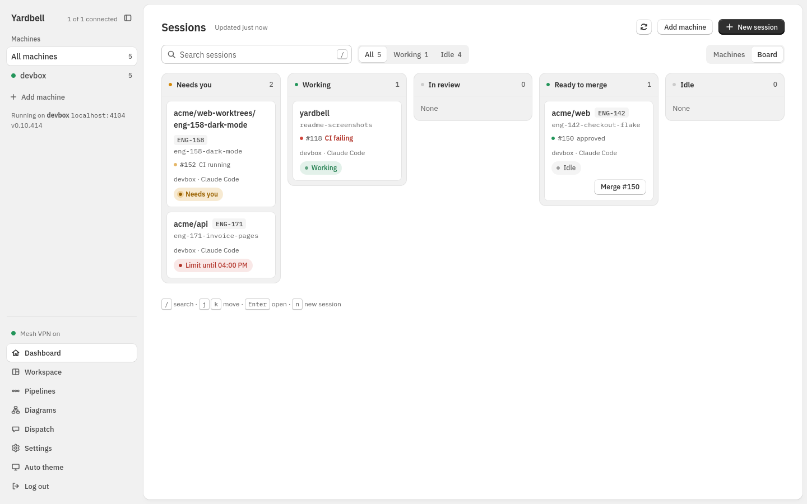
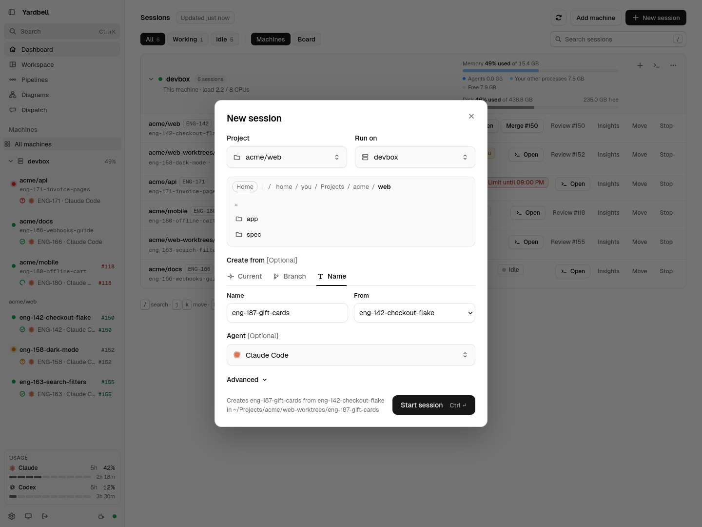
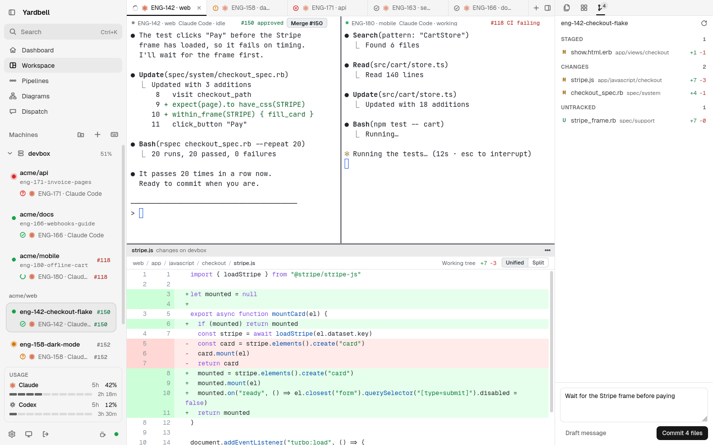
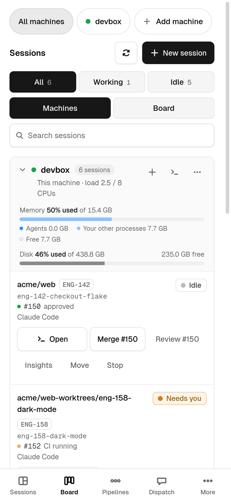
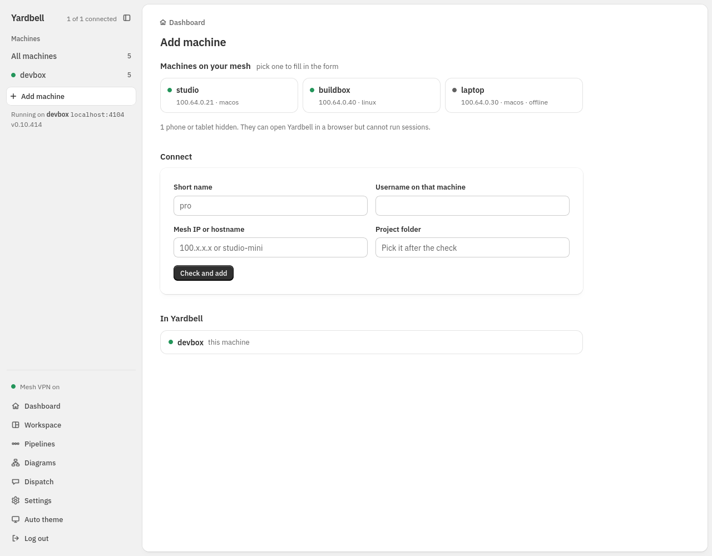
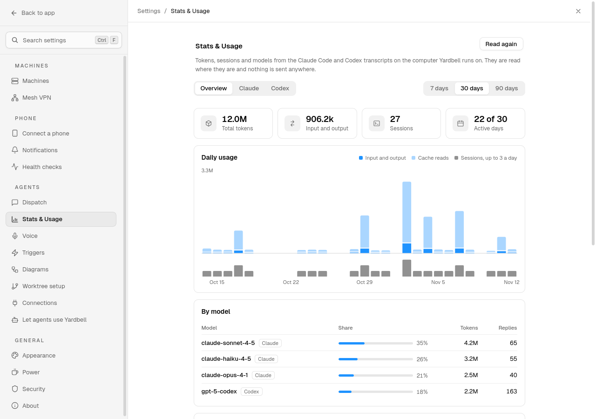
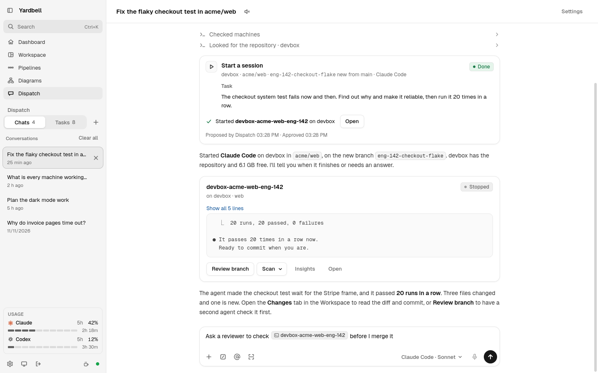

# Using Yardbell

A tour of the pages: dashboard, new sessions, Workspace, the terminal, adding machines, Settings and Dispatch.

## Using Yardbell

### Dashboard

The page is grouped by machine. Each machine gets a section: its health on top (connection, load,
memory drawn to scale, amber from 85% and red from 95%), its sessions below. The memory bar covers
the whole machine, split into your agents (blue), your other processes (light blue), other accounts
and free. On a machine shared with other people, a line under it lists the accounts using the most
memory, yours included, and when your account has its own memory limit another line shows how much
of it you use. The memory warning goes by whichever is fuller, the machine or your limit, and
Dispatch counts only the room your limit leaves when it picks a machine.
The sidebar lists the machines, problems first, with a session count; click one to show only that
machine. Every page updates by itself as soon as Yardbell has checked a machine, and a session you
stop leaves the list at once.

- **Top bar:** search sessions by folder, branch, ticket or agent (press `/`), show All, Working or
  Idle sessions (an agent waiting for you shows **Needs you** and counts as idle), **Refresh** to check every machine right away, Add machine and New session.
- **Error:** an idle Claude Code or Codex session whose last turn ended on an error rather than an
  answer, such as `API Error: 529`, a usage limit (`You've hit your limit · resets 3pm`) or Codex's
  `■ stream disconnected`, shows a red **Error** instead of Idle. Hover it for the line. It counts
  as idle and lasts until the agent writes something after it. Pressing Esc in Codex is not an
  error. A usage limit that names its reset time shows **Limit until 15:00** instead, read in the
  machine's own time zone. Once that time passes, Dispatch posts a **Limit reset** card whose **Send
  to session** types `continue`, and the phone says so (**Usage limit reset** under Phone
  notifications). A Dispatch rule that allows typing into that session sends it on its own; any
  other rule leaves the card for you. A reset more than six hours old gets no card.
- **Machine header:** fold the section away, **+** starts a new session on that machine, the terminal
  button opens a plain shell there (no agent, in its own tmux session), and the **⋯** menu has
  Machine settings, Copy ssh command and Remove machine.
- **Sessions** show folder, ticket, branch, agent, status and ports. Click a row (or press `Enter`) to
  open its terminal, use `j` and `k` to move, and `n` to start a new session. On a phone, a card
  opens only with its **Open** button, so Stop and the other buttons are easy to hit.
- **Pull requests:** a session whose branch has a pull request on GitHub, or a merge request on a
  GitLab host you listed, shows its number (`#12` or `!12`) and state next to the branch: CI
  failing, conflicts, changes requested, CI running, approved, CI passing, merged or closed.
  **Conflicts** means it can no longer merge into its base branch without a rebase. Hover it for the
  title and the checks that failed, click it to open it. Yardbell asks `gh` on the session's
  machine, or GitLab's API, every two minutes or so. A branch with no pull request has no badge. When
  something stops Yardbell from asking, such as `gh` not being signed in or a GitLab host that is not
  listed, the session shows **No PR info**: hover it for the reason, click it for **Settings, GitHub
  and GitLab**, where you switch each one on or off, add GitLab hosts and see which service each of
  your folders uses. See
  [`pull_requests`](configuration.md#pull_requests-optional).
- **Reviews of pull requests:** a session with an open pull or merge request has **Review #12**
  (or **Review !12**) among its buttons. It starts a read-only reviewer on that request in the
  Dispatch conversation that follows the session, and opens it. Beside the badge, the newest review
  of the branch shows as **review waiting** (for your approval), **reviewing**, **review: ready**,
  **3 review findings** (red when one is high, amber when the worst is medium), or **reviewed an
  older commit** once the pull request has moved past what was reviewed. Click it to open the
  conversation. See [Reviewing your sessions' pull requests](#reviewing-your-sessions-pull-requests).

**Board** (beside **Machines** in the top bar) lays the sessions of every machine side by side in
five lanes, by what each needs next:

| Lane | Holds |
|---|---|
| **Needs you** | An agent waiting for your answer or stopped on an error, or an idle one whose pull request failed CI, has merge conflicts or has changes requested. |
| **Working** | The agent is working, whatever its pull request says. |
| **In review** | An idle agent with an open pull request that is a draft, has CI running or waits for a review. |
| **Ready to merge** | Approved, CI green (or no CI) and no known merge conflict. |
| **Idle** | An idle agent with no open pull request, including one whose pull request was merged or closed. |

Each card shows the folder, ticket, branch, the pull request badge, the machine and the agent. A card
in **Ready to merge** has a **Merge** button, as does the session's row on **Machines**: it asks
first, then merges on GitHub or GitLab the way **Merge with** in Settings, GitHub and GitLab says (a
merge commit unless you pick squash or rebase). It reads the pull request again and merges only if it
is still open, approved, green and free of conflicts, at the commit the page showed, so a push since
is never merged unseen. The branch is kept. Dispatch can merge too, with its `merge_pull` step, which
asks unless a rule allows it. Click a card (or tap it on a phone) to open its terminal; `j`, `k` and `Enter` work as on the list. Search, the
All, Working and Idle switch and a machine picked in the sidebar filter the board too. The choice
is kept in the address (`?view=board`) and in this browser, so the dashboard opens the way you left
it. Sessions outside tmux and ended ones stay on **Machines**.

Sessions started outside tmux, and sessions that ended, fold into the footer of their machine's
section, since Yardbell can see them but cannot attach to them. Open the list and press **Move to
tmux** on one: Yardbell stops that agent (it asks first) and starts it again in tmux with its resume
command, so the conversation continues, then opens its terminal. The terminal it ran in before gets
its prompt back.

A session that ended in a worktree has **Remove worktree** beside Resume and Forget. Yardbell first
checks the worktree and shows what would be lost: uncommitted changes, including new files, and
commits on its branch that no remote branch and no other local branch has. With nothing to lose,
**Remove worktree** runs `git worktree remove` and `git worktree prune` from the main checkout,
and can also delete the branch when it is merged into the default branch. With something to lose
the button becomes **Remove and lose these**, and the server refuses the removal without that
confirmation too. Yardbell never removes a repository's main checkout, and refuses while a session
still runs in the worktree.

**Move** on a session moves its work to another machine, for example the one with the most free
memory, which is preselected and listed first. The branch's commits go as a git bundle and its
uncommitted changes, new files included, as a patch, over the two machines' ssh connections and
through Yardbell, so nothing is committed or pushed to a remote. On the other machine they land in
a worktree of their own at `<repo>-worktrees/<branch>`, the folder's setup command runs there, and
the same agent starts with the task, prefilled when Yardbell started the session since its last
restart, and a note that it continued from the first machine. Both clones must have the same
`origin`, and a branch that already exists there with other commits is never overwritten. The
original keeps running unless you tick **Stop the original**, and the dialog offers to stop it once
the new session runs.

**Insights** on a session, also on one that ended, shows what Yardbell saw of it: its status,
machine, folder, branch and agent, when it started (or that it was already running when Yardbell
started watching), and how long it worked, waited for you and sat idle, each with its share of the
time and a line on what it means, then a bar and a timeline grouped by day, and the tool calls and
test runs its screen showed, such as Claude Code's `Bash(cargo test)` or Codex's `Ran npm test`,
with **Passed** or **Failed** for a test runner's summary line. Runs still in the scrollback from
before Yardbell recorded them are listed under **Earlier, from the scrollback**, without times.

For a Claude Code session, each stretch of the timeline also says what happened in it: what you said,
what the agent did (such as "Edited 3 files, ran 12 commands"), and the last thing it said. **Show steps**
opens every step. A wait says what the agent asked you, or the step it stopped at. This comes from the
session's transcript on its machine, with saved secrets removed. Other agents show the end of their
terminal instead. When two sessions run in one folder, Insights says the detail may be from the other one.

When the session's branch has a pull request or a GitLab merge request, Insights shows it under the
facts: its number and title as a link, the same state as the badge, and where CI and the review
stand. Its timeline also says what happened to it while the session ran: when it was opened (or
that it was already open), marked ready for review, approved and by whom, when someone asked for
changes or commented (with the file and line of a comment on the code, and several comments at once
as one entry), and when it was merged or closed. Each entry links to the pull request or the
comment. Yardbell takes these from the checks it already makes for the badge, so they come within a
couple of minutes.

Yardbell records each change from the checks it already makes, keeps up to 300 changes for each of
the last 100 sessions, and keeps them across restarts in `insights.json` in its state folder. None
of this asks an AI. The same **Insights** is in a Workspace pane's **⋯** menu and on a Dispatch session card.

**Suggest a better prompt**, in Insights and in the pane's menu, asks Dispatch, as a message you
send, to read the session's task and scrollback and propose a clearer, more complete prompt for the
next time. The reply ends with the proposed prompt, and **Save as a new task** puts it in the task
form, or, when the session came from one of your tasks, **Save as version 4 of** that task saves it
as the task's next version.

### New session

1. Pick the folder under **Project**, from **Recent** or by browsing the machine, and the machine
   under **Run on**. Git repositories show their branch. **Project** folds the browser away and
   opens it again.
2. Pick an agent. The list holds the agents installed on that machine, and the one you used last is
   preselected. **Other agent…** shows the rest, marked as not found there, and **Add an agent…**
   saves a new one by its name and command.
3. For a git repository, **Create from** stays on the current branch (**Current**), picks another
   branch (**Branch**), or creates a new one from a base (**Name**). Any branch other than the current one opens in its own worktree at
   `<repo>-worktrees/<branch>`; an existing worktree for that branch is reused. A branch with a
   worktree has **Remove** in the list, and a folder that is a worktree says so above its
   subfolders with **Remove worktree**, both with the same checks as on the dashboard.

When Yardbell creates a worktree for a repository that has a setup command (Settings, **Worktree
setup**), the command runs in the new worktree before the agent starts, through your login shell,
with the main checkout's path in `$YARDBELL_MAIN_CHECKOUT`, for example `bin/setup`, `npm ci` or
`cp "$YARDBELL_MAIN_CHECKOUT/.env" .`. Its output is saved in the worktree's git folder as
`yardbell-setup.log`, and the session row shows **Setup ran** or, in amber, **Setup failed** or
**Setup timed out**; click it for the output. A command that fails or runs past its timeout (5
minutes unless you set another) is stopped with everything it started, and the agent starts anyway:
its task gets a note that the setup did not finish and where the log is. The row's mark lasts until
Yardbell restarts; the log stays until the worktree is removed. A reused worktree does not run the
setup again. [Worktree setup](automation.md#worktree-setup) has examples, such as a Rails app that
needs `.env` and `bundle install`.

**Start session**, or **Ctrl+Enter** (**⌘↵** on a Mac), starts it. The footer always says where the session will start. Yardbell starts the agent inside a new tmux
session through your login shell, so your PATH and environment apply, then opens its terminal.
**Continue the last conversation** and **Resume** on an ended session use the agent's own resume
command, listed below. Starting an agent in a folder that already has a session starts a second
one, named like the first with `-2` after it.

### Workspace

The **Workspace** page shows terminals side by side. Its sidebar lists every terminal as a tree:
machine, then folder (a workspace), then the sessions in it, each with its state. A session with a pull request shows its number, colored by its state, and
the full state on hover, followed by its newest review as on the dashboard. A pane's **⋯** menu has
**Review pull request #12** for a session with an open one, which opens the review in the Dispatch
panel. Click a workspace
to switch to it and a session to open it in the focused pane. Each workspace has tabs: **+** opens the New
session dialog in that folder and the new session in a tab of its own, and closing a tab with
sessions in it asks whether to stop them or keep them running. Double-click a tab to rename it, or
right-click it to rename or close it, or to move its panes into another tab. When the tabs do not fit, scroll the row with the mouse
wheel, a trackpad or a swipe, or click the arrow button at its end for a list of every tab. The tab
you switch to always scrolls into view, and a tab's tooltip shows its full name.
A tab lays its panes out as an even grid: two side by side, three as a pair over a full-width
pane, four as two by two. Moving panes in or closing one lays the grid out again. To rearrange,
drag a pane by its title bar onto another pane and they swap places, or pick **Swap with** from
the pane's **⋯** menu.

Tabs, panes and sessions also dock by dragging, on a desktop:

- **A tab** dragged along the tab row moves there, with a line marking the spot. Dropped near an
  edge of a pane, every pane in the tab moves next to that pane on that side, and the tab goes away.
  A tinted box shows the half of the pane it will take. Dropped in the middle of a pane, or on its
  title bar, a tab with one pane swaps places with that pane, and a tab with several moves them all
  into the tab. Hold a dragged tab over another tab for a moment to switch to it and drop there.
- **A pane** dragged by its title bar docks next to another pane the same way, swaps with it in the
  middle, or becomes a tab of its own when dropped on the tab row.
- **A session** dragged from the sidebar opens next to a pane or in its place, or in a new tab when
  dropped on the tab row. An empty pane it lands on is replaced; any other pane takes the session's
  old place in its tab, or a tab of its own. A session already open in the tab moves instead of
  opening twice.

Esc cancels a drag. The layout is remembered, like the rest of the Workspace. An empty pane offers to start an
agent there or to open one of the workspace's sessions. Panes also split right or down and resize by
dragging the border between them; the split's shape lasts until a pane is added or removed, when
the grid takes over again. **Keyboard shortcuts** in the sidebar lists the keys. On a phone
the sidebar comes first and a session opens full screen. Its name at the top, with its state, is a
switcher: tap it to list the running sessions and pick another, or swipe it sideways for the next or
previous one. The back arrow still returns to the list.

**Dispatch** sits in the Workspace too, as a panel between the sidebar and the terminals. Sessions
it starts or links to open in a pane. Hide or show it with the speech bubble before the tabs or the
button at the top of the panel; the Workspace remembers whether it was open. **Dispatch** in the
sidebar menu opens the full Dispatch page. The sidebar menu is the same as on every other page,
with **Dashboard** first, and the sidebar folds to icons the same way. The panel is too narrow for
the lists beside the chat, so it shows one at a time under three tabs, **Chat**, **Chats** and
**Tasks**, with **+** for a new conversation; picking a conversation or running a task goes back to
**Chat**. The Dispatch page does the same on a phone.

Click a machine's name in the sidebar to fold its folders and sessions away. Drag the right edge of
the sidebar to resize it, and double-click the edge to reset it. On the Dispatch page the sidebar
holds the conversations and tasks, under the **Chats** and **Tasks** switch. The
sidebar keeps the same width on every page.

The button at the right end of the tab row shows or hides a panel on the right, for the folder of
the focused session or of the workspace picked in the sidebar. Drag its left edge to resize it; the
Workspace remembers whether it was open, its width and its tab. It is not shown on a phone.

- **Files** browses the folder on its machine. **Names** finds files whose name has what you type,
  and **Contents** finds files that contain it (both skip `.git`, `node_modules` and `target`, and
  stop at 200 matches). Click a file to open it read-only in a tab of its own, with line numbers and
  colours for common languages. Files over 1 MB and binary files are not shown. Nothing outside the
  folder can be opened, through `..` or a link.
- **History** lists past Claude Code sessions, read from the machine's own transcripts: **Workspace**
  for this folder, **All** for every folder on that machine, newest first, with Claude Code's title
  or the first prompt, the last reply and the number of messages. Search filters the list. **Resume**
  starts a new tmux session in that session's folder running `claude --resume` with its id, and
  opens it in a pane.
- **Changes** lists what git sees as changed in the folder, under **Staged**, **Changes** and
  **Untracked**, each file with its status letter, its folder and the lines added and removed. The
  branch sits at the top, with how far it is ahead of or behind its upstream. The count on the tab
  icon is the number of changed files. The list reads git again every 5 seconds while the tab is
  open and the page is in front, and **Refresh** reads it at once.
  - Click a file to open its diff in a tab of its own: against the index for a working tree change,
    against the last commit for a staged one, and all lines added for a new file. **Unified** or
    **Split** is remembered in this browser. Unchanged runs fold away behind **Show N lines**.
    Binary files say so instead of showing a diff.
  - Hover a line and click **+** to leave a note for the agent under it. Notes can be edited or
    removed, and stay in this browser until they are sent. **Send notes to agent** (in the diff tab
    for that file, or **Send notes** in the Changes tab for every file in the folder) puts each note
    as `path:line`, the line quoted, then the note, into the prompt of the session running in the
    folder. When more than one session runs there, it asks which. Tick **Send now** to press Enter as
    well; otherwise the text waits in the prompt for you to finish. Sent notes are cleared.
  - The box at the foot commits every listed file with the message as written. **Draft message**
    writes a first line from the file names ("Update a.rs, add b.md"), to edit before committing.
    **Commit N files** (or **Ctrl+Enter**, **⌘↵** on a Mac) stages and commits, then shows the
    short commit id. Nothing is pushed.

The folder button over the machines opens **Add a project**: pick the machine under **Host**, then
**Browse folder** to the folder and **Add project**. The folder stays in the sidebar in this browser,
selected, so **+** starts a session there even before it has one.

There is no bar along the bottom. The right of the sidebar's foot, beside Settings, theme and log
out, has a cup for **Keep computer awake** (**On**, **While agents work** or **Off**, see Settings,
**Power**; blue while it holds the computer awake, struck through when the tool it needs is
missing), a plug with the number of live ports when there are any, and a dot for the connection:
green while live, amber and pulsing while reconnecting. The plug lists the ports Yardbell forwards,
grouped by machine, each with its service and a link that opens it on this computer. After 3
seconds without a connection a **Reconnecting to Yardbell…** banner shows at the top of the page
until it is back. With the sidebar folded the same three sit at the bottom of the rail; on a phone,
**More** has **Keep computer awake** and **Live ports** rows. Each machine's memory is in the
sidebar's machine list and in the **Machines** part of the usage sheet, and the usage card adds a
line only for a machine that is down or short of memory.

### Terminal and phone

Turn on the mesh VPN on your phone and open `http://<host-mesh-ip>:4000`. Everything works the same,
including the terminal. Several devices can attach to one session. The one you are using sets the
session's size: opening it, clicking in it or typing takes over, and a tab you cannot see or a
phone in the background never does.

On a phone the pages sit in a tab bar along the bottom, the machines stay on top, and sessions become
cards. Yardbell follows the system light or dark setting, or the theme you pick with the button in
the sidebar, on each device.

 

**The terminal on a phone.** A touch screen, or a window as narrow as a phone, gets a key bar under
the terminal:

- **Keys.** Esc, Tab, Shift-Tab, Ctrl, Alt, Shift, the arrows, `/`, `|`, `~`, `-`, Enter, Ctrl-C,
  Ctrl-D and Paste. Swipe the bar sideways for the rest. Tapping a key never closes the phone's
  keyboard. Holding an arrow, Tab, Backspace, Del, PgUp or PgDn repeats it.
- **Ctrl, Alt and Shift are sticky.** One tap arms the key (it gets a blue ring) for the next key you
  press, on the bar or on the phone's keyboard: Ctrl then `c` sends Ctrl-C, Alt then Backspace sends
  Alt-Backspace. A quick double tap locks it (filled blue with a bar under the name) until you tap it again.
- **More keys.** **⋯** at the end of the bar opens a sheet with Home, End, PgUp, PgDn, Backspace, Del,
  Ctrl-Z, Ctrl-L, Ctrl-R, F1 to F12 and any key you hid from the bar. It also has the text size
  (**A-** and **A+**), **Select text** and **Copy text**. **Edit bar** lets you tick the keys to show
  and move them earlier or later; each device remembers its own bar, and **Reset to default** brings
  the standard one back.
- **Text size.** Pinch the terminal to make the text bigger or smaller. When you let go it settles on
  the nearest size between 10 and 20 px and the screen refits. The device remembers it.
- **Selecting.** Long-press a word to select it, keep your finger down and drag to select more, or
  drag the blue handles at either end. The menu above it has **Copy**, **Select all** and **Paste**;
  tap anywhere else to stop. **Select text** in More keys starts on the line with the cursor.
- **Links.** Tap a web address on the screen to open it in a new tab. On a desktop, Ctrl-click
  (Cmd-click on a Mac) does the same.
- **Paste** reads the clipboard in the Yardbell apps and on `https` pages. Over plain `http` the
  browser does not allow that, so a box opens: paste into it with your phone's own menu and press
  **Send to terminal**.
- **The keyboard.** While the phone's keyboard is up, the key bar sits on top of it and the terminal
  slides up just enough to keep the line with the cursor in view. The session keeps its size, so the
  agent's screen is not redrawn every time the keyboard opens; turning the phone does resize it.

**Driving an agent from a phone.** On a phone or a touch screen, a row of agent keys sits above
the key row, and its buttons follow what the session's screen shows. While Claude Code works:
**Stop** (Esc) and **Send now** (Ctrl-X Ctrl-S, which sends a queued message right away). When it
asks for permission: **Yes**, **Always** (the "don't ask again" choice, when it offers one) and
**No**. When it asks a question with numbered choices: one button per choice and **Cancel**. When
it waits for you: **Mode** (Shift-Tab), **History** (Up) and **Clear line** (Ctrl-U). Codex gets
**Stop**, **History**, and Yes, Always and No by the letters it prints beside them. Each button
shows the keys it sends. When Yardbell cannot tell what the screen asks, or right after you answer
and before it has read the screen again, only **Stop** shows, so an old answer never lands on a new
question. Other agents and plain shells get only **Type**.

**Type** opens a message box: write as many lines as you like and **Send** types them into the
session and presses Enter (several lines go in as one paste). The microphone dictates into the box
with the same voice setup, mode and shortcut as Dispatch. The paper clip attaches images, PDFs and
text files up to 10 MB: each one is copied to the session's machine, into
`/tmp/yardbell-uploads/<session>/`, and its path goes into the message for the agent to read. The
file's chip shows the upload's progress, and says why when a file is refused.

**Copying from the terminal.**

- **Drag to select.** With tmux mouse mode on (`set -g mouse on`), tmux makes the selection and
  sends it to your clipboard when you let go. Yardbell asks tmux to do this for its terminal.
- **Shift-drag** (Option-drag on a Mac) selects in the browser instead, and copies when you let go.
- **Copy text** in the header shows the screen as plain text. Select any part of it, or press
  **Copy all**, which copies everything and takes you back to the terminal. **Close** or Esc goes
  back too. On a phone, it is the fallback when selecting on the terminal is awkward.

Browsers only allow automatic clipboard access on `https` pages or `localhost`. Over
`http://<host-mesh-ip>` Yardbell copies straight away when it can. If the browser blocks it, a
**Copy** button appears for a few seconds; tap it to finish copying. If the browser refuses that
too, a message points you to **Copy text**.

### Add machine

Pick a peer from your mesh (phones and tablets are hidden) or type an IP or hostname, then enter the
username and a short name. Yardbell checks each step and stops with the reason when one fails:
reachable, ssh key login, the `~/.ssh/config` entry (shown before it is written, backed up first,
never overwriting an existing `Host`) and installed tools. Then it lists that machine's folders,
starting from the usual project folder when it finds one: click through to the folder that holds
your projects and press **Use this folder and save**. The new machine gets a port prefix, and the
last step says which port its apps open at on the host.

### Settings

Settings shows one section at a time; pick it from the section list (a row of buttons on a phone).

- **Machines:** edit ssh host, mesh address, port prefix, project folder and VPN override, or remove
  a machine. Each remote machine says what its port prefix means in real ports, for example port
  3000 opening on the host at 13000, see [Ports](running.md#ports).
- **Mesh VPN:** choose a provider and press **Check addresses**. Yardbell reads the new VPN's peer list
  and proposes each machine's new address. **Switch VPN** saves `yardbell.yml` and updates the matching
  `HostName` lines in `~/.ssh/config`, with backups of both. If the host's own address changes,
  restart Yardbell (a button does it when Yardbell runs as a service).
- **Connect a phone:** shows a pairing code for the Android app.
- **Notifications:** which notifications the Android app shows, including **Pipeline needs you**,
  **Pipeline finished** and **Proposals**, and whether it is connected, see
  [Phone notifications](apps.md#phone-notifications).
- **Dispatch:** your own instructions for Dispatch, the agent it starts, the model it runs on and
  whether it asks before each step, see [Dispatch](#dispatch). **Memory** below them lists what
  Dispatch remembers, to add, edit or delete, with the history of changes, see
  [Memory](#memory).
- **Triggers:** start a saved task on a schedule, or for a Linear or GitHub ticket that comes your
  way, see [Triggers](#triggers).
- **Worktree setup:** a command to run in each new worktree, and one to clear it when a pipeline run
  ends, see [Worktree setup](automation.md#worktree-setup).
- **GitHub and GitLab:** rows under **Connections**. See [below](#linear-github-and-gitlab).
- **Connections:** the outside tools pipelines can use, such as Trello, with **Test**, **Share** and
  **Import**, see [Connectors](automation.md#connectors).
- **Let agents use Yardbell** and **Connections:** turn on Yardbell's MCP server and list other MCP
  servers for the sessions it starts, see [Agent tools (MCP)](agents.md#agent-tools-mcp). Their
  tokens go in **Secrets** under the list: add, replace or delete one by name, and refer to it as
  `${secret:NAME}`. A saved value is never shown again. When `yardbell.yml` still holds tokens
  itself, **Move to secrets** moves them, see [Secrets](configuration.md#secrets).
- **Appearance:** same as the device, light or dark, like the theme button in the sidebar.
  **Terminal** picks light or dark for terminals on its own, or follows the theme.
- **Power:** **Keep computer awake** stops the computer Yardbell runs on from sleeping: **On**,
  **While agents work** (while an agent on that computer is working) or **Off**, the same choice as
  the cup in the sidebar's foot. Yardbell holds `systemd-inhibit` on Linux or `caffeinate` on a Mac,
  lets go when it is off or Yardbell stops, and says so when neither is installed.
- **Security:** change the passcode (takes effect immediately) and log out every other device.
- **About:** which Yardbell the server runs: its version and build, the machine, system and
  architecture it runs on, how long it has been running, and where its config and state live, with
  links to this version's release notes, the changelog and the docs. Opening it asks GitHub for the
  latest release (at most once an hour) and says **Up to date** or which version is available.
  Nothing is installed for you. In the desktop app it also shows the app's own version, with a
  warning when the app and the server it is connected to run different releases. The version next
  to "Running on" at the bottom of the sidebar opens this section, and so does **About Yardbell**
  in the desktop app's tray menu.
- **Undo** restores the previous `yardbell.yml` and `~/.ssh/config` after any change.

#### Diagrams

The **Diagrams** page draws interactive maps of your repositories with
[Archify](https://github.com/tt-a1i/archify). Each machine shows whether it is ready, and **Install** downloads a fixed
version, checks its checksum, and unpacks it to `~/.local/share/yardbell/archify/`, not to any agent's skills folder. The
machine needs Node 18 or later, which Yardbell does not install. **Settings, Diagrams** also has **Remove**.

**Draw architecture** asks for a machine, folder, agent and anything to focus on, then starts a normal session you can
watch or stop. It uses that agent's tokens. The diagram is saved in the folder's `.archify`, which Yardbell adds to the
repository's `.git/info/exclude`. On a machine with no Chrome, Chromium or Edge, Archify cannot run its last check, and
the agent keeps the diagram and says so.

A diagram opens inside Yardbell, in a frame that cannot reach your login, Yardbell's API or the network. It holds what the
agent read from the repository, and saved secrets are not removed from it, so check it before sharing it.

It can also draw from a description, as a plan for something not built yet: choose **A description**, say what to draw,
and save it in a folder you have or a new one, which Yardbell makes as a new git repository under the machine's root. It
never reuses a folder that already exists.

**Build from this** on a diagram starts a pipeline run that works from it. Choose one of your by-hand pipelines, or let it
add **Implement from a diagram**, which writes a task list and waits for you to approve it before changing any code, then
implements, reviews, fixes, pushes a draft pull request and reports. **Run now** on a by-hand pipeline has the same choice.
A run keeps its own copy of the diagram's source with saved secrets removed, so drawing again does not change it, and a
step can quote it with `{diagram}`. A diagram shows the parts and how they connect, not their behaviour, so the first step
asks what it leaves unclear.

Dispatch can read diagrams with `list_diagrams` and `read_diagram`, start a run on one, and propose a drawing with
`draw_diagram`, which your rules decide like any other session.

#### Linear, GitHub and GitLab

Linear has a row under **Settings, Connections** for its API key, saved as the secret `linear`.
If you also have an MCP server at `mcp.linear.app`, it shares that row, which names the machines whose agents
use it, and **Edit** has a section for each.

GitHub and GitLab are rows under **Settings, Connections**, each with a **How it connects** choice:

| Service | Choice | What it needs |
|---|---|---|
| GitHub | **Local gh**, the default | `gh` installed and signed in on each session's machine |
| GitHub | **A token** | A token saved here, for github.com only. Machines need nothing installed |
| GitLab | **A token for each host**, the default | A token for each GitLab host |
| GitLab | **Local glab** | `glab` installed and signed in on each session's machine |

A token pasted here is saved as a secret by itself. The switches for showing them, Dispatch cards and
how often to check are under **Pull and merge requests** on the same page.

This decides how sessions get their pull or merge request badge and CI.

- **Show pull and merge requests** and **Post a card in Dispatch** switch the badges and the cards,
  and **Check every** sets how often each branch is asked about.
- **GitHub through local gh** needs nothing entered. Yardbell asks `gh` on each session's machine, so each
  machine needs it installed and signed in with `gh auth login`. Each machine shows `gh works`, what is wrong, or
  **Not checked yet**, which lasts until a session there has a branch.
- **GitLab** needs each server your folders use. Press **Add GitLab host** and enter the host as your
  remote address names it. With **A token for each host**, paste a personal access token with the
  `read_api` scope, or `api` if a pipeline opens merge requests, or pick a saved secret.
  **Address** is only for an instance whose web address differs, such as another port. Each host shows
  whether its token works.
- **Your folders** reads each folder's `origin` remote when the section opens, and says which service
  it uses and whether it is ready. A folder on a GitLab host you have not added offers a button that
  adds it. A self-hosted GitLab without "gitlab" in its name shows as not known, with **Add as
  GitLab**, because a name cannot prove what a server runs.

The **GitHub** and **GitLab** switches stop badges and cards for that service and keep what you
entered. A pipeline can still open a merge request with GitLab switched off.

### Pipelines

The Pipelines page shows your [pipelines](automation.md#pipelines), one card each: its trigger in
words, its steps in order (`Review ⟲ Fix` marks a loop back), an On/Off switch, its version, how many
runs are running, waiting and done, and **Needs you** when one waits.

- **Waiting for me** lists every run that waits for you, across all pipelines, and any run held for 30
  minutes because its machine is short of memory.
- **New pipeline** starts an **Empty pipeline** or copies a template, switched off.
- **Settings** sets the agent steps at once per machine, a step's time limit, an optional memory limit
  that holds new steps, and QA notes per folder.

A run keeps to one agent session: its steps take turns in it, in one worktree. A step marked
**Review: new read-only session** gets a reviewer of its own, which stops when nothing needs it, as
does a step on another machine or with another agent. When a run ends or is dropped, every session
stops and the worktree stays. Give a folder a teardown command under Settings, Worktree setup (for
example `docker compose down`) to clear what its worktree started. Settings, Phone notifications
has switches for **Pipeline needs you**, **Pipeline finished** and **Proposals**.

A pipeline opens full screen (the button beside **Delete** puts it back in the page) with three tabs:

- **Build**: the steps on a canvas. On the left, the library: drag a step onto the canvas, or click
  one to add it after the selected step; the **Start when** items set the trigger. Drag a card to
  move it. Each card has three dots on its right, for **pass**, **fail** and **needs you**: drag
  from one onto another card to draw that line, or onto empty canvas to pick a new step already
  connected. Click a card, the **Start when** card or a line to edit it in the panel on the right;
  **Delete** removes the selected step or line, and lines into a removed step go back to ending
  the run (pass) or waiting for you. **Undo**, **Redo** and **Tidy** (lines the steps up along
  their pass line) sit at the top left; arrows nudge a card, and Ctrl+S saves. **Save** lists what
  the checks find over the canvas and rings each step it names.
- **Runs**: its runs, newest first. **Run now** on a connected tool takes item ids or links. The chosen run shows on the same canvas: steps done in green,
  the current one outlined (amber when it waits for you), and the rest faded, with lines coloured
  by outcome. Beside it are links to the ticket, the pull or merge request, the draft and the
  conversation; the waiting box with **Send answer**, **Retry step**, **Continue on pass**,
  **Continue on fail** and **Drop**; and each step's report.
- **History**: every saved version. Click one to see it on the canvas, then **Restore** it or go
  **Back to the current version**. Restoring makes that version the current one without adding a
  version, so a newer one can be restored again; the next edit saves as the newest. The bin on a
  version deletes it, and **Clear history** keeps only the current version. The current version
  cannot be deleted, and a deleted number is never used again.

On the **Runs** tab:

- **Show terminal** opens the run's live terminal under the canvas, and **Hide terminal** gives the
  canvas its room back. It starts closed, each device remembers your choice, and it follows the run
  you pick. During a review it can switch between the reviewer and the main session.
- **Stop session** stops the session shown. If that is the current step's, the step waits for you
  rather than starting the agent again.
- **Stop this run**, or **Drop** while it waits for you, ends a run and stops its sessions. It stays in
  the list.
- **Click a step** on the canvas, or its name in the list, to see what it did: its outcome, when it
  started and ended, how long it took, how many times it ran, the machine, folder and session, its
  report and details, your answer if it asked, and each round it ran. Click it again, the empty
  canvas or **This run** to go back. The run's own view lists its whole history, failed review
  rounds included, and its final report.
- Under the canvas, a picked step shows its live terminal while its session is open. Once the
  session is gone, it shows the agent's saved transcript, read only, as a conversation with each
  tool call and its result. Yardbell reads Claude Code transcripts from the step's folder on its
  machine, so the machine has to be reachable; when there is none, it says why. This works for runs
  that finished before the transcript view existed.
- **Delete this run** shows once a run is done or dropped; drop a run still going first.
  **Delete finished runs** at the top of the list deletes every done or dropped run of the pipeline
  and keeps the others. Deleting removes only the run's record. Branches, pushed commits, pull and
  merge requests, worktrees, Dispatch conversations and transcripts stay, and the question names any
  worktree it made and any session still open. **Delete** in the pipeline's bar removes the pipeline
  and its finished runs, and refuses while any of its runs is still going.

[How a run works](automation.md#how-a-run-works) explains sessions, results and waiting.

On every canvas, drag or scroll with two fingers to move around; pinch, Ctrl or Cmd with the wheel,
or **−**, **+** and **Fit** zoom; the overview at the bottom right moves the view. Leaving with
unsaved changes asks first. On a phone, **Add step** opens the library as a sheet and a tapped step
opens in a sheet with **Done**.

**Run now** starts a run, asking for ticket ids or links when the trigger needs them. In Dispatch's
list, each run's conversation has the pipeline mark.

### Dispatch

The **Dispatch** page takes a task in plain words, like "fix the flaky checkout test in acme/web on a
new branch eng-1234-checkout-flake". It runs Claude Code (`claude -p`) or Codex (`codex exec`) on
the host, as **Dispatch runs on** in Settings says, with only Yardbell's own tools, so it can look
at machines, folders and sessions and start, read and answer sessions, but cannot change files
itself. It picks a machine that is up and has the repository,
preferring the most free memory, the lowest load and the fewest running agents, then proposes
starting the default agent there with your task. Follow-up messages continue the same
conversation, for example "what is that session doing now?" or "tell it yes".

To show Dispatch a screenshot, a log or a PDF, drop the files on the conversation, paste them into
the message box, or pick them with **+**, **Attach files**. Each one sits above the text as a thumbnail
or a file chip until you send, with **×** to take it back, and a message can be only files. Dispatch reads images, PDFs and text files
(anything that is UTF-8 text: logs, code, JSON, CSV). A message takes up to 10 files, images up to
5 MB each, PDFs up to 32 MB, text files up to 256 KB, and 40 MB in all. Codex cannot read PDFs, so
a conversation on Codex refuses them. Files stay with their conversation, open from the message
they came with, and go when the conversation is deleted. They are not passed on to the sessions
Dispatch starts.

You can also talk instead of typing. **Settings, Voice** sets it up in one click: **Set up**
downloads the recommended Whisper model, finds whisper.cpp on the machine Yardbell runs on and
turns voice input on, and the **Speech model** list below it downloads, switches and deletes the
others. Then a microphone button sits in the message box: tap to record and tap again to stop, or
hold it and speak while it is held. **⌘E** on a Mac, or **Ctrl+Shift+Space** elsewhere, does the same
from the keyboard; macOS keeps Control+Space for switching keyboards, which is why a Mac differs.
**Shortcut** under **Input** sets your own on each device: click **Change** and press it. Under
**Dictation mode**, **Hold** records only while held and **Toggle** only starts and stops, and only
**Auto** stops by itself after a few seconds of quiet. Words
appear while you talk: each time you pause, what you just said is transcribed and typed in. While it records, a pill over the box shows how loud the
microphone hears you and for how long, with **×** to throw the recording away (so does **Esc**) and
**✓** to finish. **×** and **Esc** keep the words already typed in. A few seconds of quiet after you
speak finishes it too. What you said is typed in where the cursor was, for you to check and send.
If a transcription fails, the pill keeps the recording and offers **Retry**. The recording is
transcribed on the machine Yardbell runs on with [whisper.cpp](https://github.com/ggml-org/whisper.cpp),
or by the speech-to-text API the same section names, see
[`voice`](configuration.md#voice-optional). In the Yardbell apps the microphone just works; a
browser only opens it on a secure page, so there dictate over `https://` or on the machine
itself. And Dispatch can talk back: the speaker button at
the top reads replies, errors and session changes ("hp-eng-1234 is waiting for you") aloud with
this device's own voice. It is off by default, speaks one thing at a time, and pressing it again
mutes it at once. The same switch is under Settings, Voice, and is saved per device.

Dispatch also reads Yardbell itself, so you can ask about it in the same words: "which triggers
run on weekdays?", "what did the review pipeline find on !87?", "why did that run stop?", "how
much Claude usage is left?" or "which pull requests have failing CI?". It reads Settings, its
other conversations, your saved tasks, pipelines and their runs, Insights, pull and merge requests
and usage; these reads change nothing and never show a secret.

It can change Yardbell too: "phone me only after 10 minutes", "add a trigger that runs Morning
summary on weekdays at 08:30", "save this as a task" or "run the Tickets trigger now". Each change
is a card like any other step. A settings card shows the area before and after as a word diff,
checked as Settings checks it, and **Edit** opens the value as JSON. Leave each `(hidden)` as it
is: it keeps the saved credential. **Open in Settings** goes to the section. Once saved, Settings'
**Undo** reverses it. Changes to Dispatch's own settings, and changes that put a saved secret to a new use, always wait
for you, even when your rules allow every step; a rule can still refuse them. A saved credential
stays with its server or host: if Dispatch changes where an entry points, it has to be entered
again in Settings. Security settings, machines being added or removed,
secrets and the passcode are never changed this way.

Dispatch builds pipelines the same way: "make a pipeline that reviews my merge requests, tests on
devbox and reports to me", "on fail, send the review back to the fix step", "turn the nightly
pipeline on", "run the review on !87" or "tell the waiting run to use the shared stack". A new or
changed pipeline is drawn small on its card, with the steps and lines that changed and each
agent's wording as a diff, and always waits for you. **Edit in the builder** opens it in the
builder, where **Approve and save** saves it; a new pipeline starts switched off. In the builder,
**Ask Dispatch to change it** starts a message to Dispatch about that pipeline.

### Proposals

The menu only shows **Proposals** while something waits there. **Settings, Let agents use Yardbell** links to the page at any time.

Other MCP clients, such as Claude Code with Yardbell added, can ask for the same changes. They wait
on the **Proposals** page, linked from the sidebar with a count while any wait, and your phone says
"A proposal from claude-code waits for you" (once, however many arrive together). Each proposal is
the same card Dispatch's steps use: **Approve**, **Edit**, **Reject**, and **Edit in the builder**
for a pipeline. Nothing changes until you approve it, whatever your Dispatch rules allow; a rule
that refuses an action refuses proposals for it too. **Delete** discards a proposal, and **Clear
decided** removes the ones already decided; decided proposals are also dropped after 30 days.

Dispatch asks before it acts. Each step that starts, stops or types into a session appears as a
card with the machine, folder, branch, agent and task (or the text to type), and waits for you:

- **Approve** runs it. The card then says what happened, with **Open** for a session it started.
- **Edit** lets you change the machine, folder, branch, agent and task, or the text, and then
  approve it with your changes. The card keeps what Dispatch proposed.
- **Reject** drops it.

With several steps waiting, **Approve all** and **Reject all** decide them together, one after
another. Sending a new message withdraws the steps you have not decided on, so Dispatch can
propose again with what you wrote, and every message tells Dispatch what happened to its steps
since its last reply. A conversation in the list says how many steps wait for you. To let Dispatch
go ahead without asking, as earlier versions did, change **Before Dispatch starts, stops or types
into a session** in Settings; its steps still show up as cards, marked as run without asking. The
same setting can refuse every step unless a rule allows it.

**Rules** under that setting decide some steps differently, for example "Stop a session, Any
machine, Deny" or "Start a session, devbox, acme/*, Allow". Each rule picks a step, a machine and
optionally a folder (a name from the folder list or a path, with `*` for any part of a name), and
then allows it, asks you, or denies it. Deny always wins. Otherwise the rule that names the most of
step, machine and folder wins, so the order of the list does not matter. A card that a rule
decided says so at the bottom, like "Your rule: start sessions on devbox in acme/*". A denied step
never becomes a card: Dispatch is told which rule refused it and says so in its reply. How rules,
your instructions and Dispatch's memory work together, with examples, is in
[Dispatch rules, instructions and memory](automation.md#dispatch-rules-instructions-and-memory).
**Groups** start several sessions as one step, for example "try three approaches to this bug" or
"run the same task in api and web". Dispatch proposes them with its `start_group` tool, and they
appear as one card: each child has its own label, machine, folder, branch, agent and task. Your
rules decide each child on its own, so one can start at once, another wait for you and a third be
refused, with the rule that refused it shown in its row while the others go on. Each waiting child
has its own **Reject**, **Edit** and **Approve**, and **Approve all** or **Reject all** at the
bottom of the card decide every child still waiting. Two children in the same checkout must work
on different branches.

Each child's task ends with a request for a short result block (`YARDBELL RESULT`, then `status:`
done, partial or failed, `summary:`, `branch:` and a line per detail, then `END RESULT`). The card
shows each child's state as it runs: working, needs you, done or ended. A child that asks a
question also gets a session card, so you can answer it from Dispatch. When every child that
started is done (it went quiet after working, or it ended), or when the group's time is up (60
minutes by default, counted from when the last child was decided), Yardbell reads each child's
screen and posts one **Results** card: per child the status, summary, details and branch, the end
of its screen when it wrote no result block, and **Open** and **Review branch**. A child still
waiting for an answer shows as **Needs you** and does not hold the results past the time limit.
Dispatch hears the results with your next message. When Dispatch said what it will do with them
(say, compare them and recommend one), Yardbell starts that one turn as soon as the results are
in, shown as a message sent by Yardbell, unless the conversation is answering or has steps waiting
for you. A group started in such a turn never starts another turn on its own. Groups keep going
after a restart.

Dispatch can also work with worktrees, each a step under the same approval and rules: **Integrate
branches** brings several branches made from one base together on a new branch in its own
worktree, one at a time in the order given, by merge or by rebase, and stops at the first
conflict, undoes it and names the conflicting files; **Push a branch** pushes, never forced, after
scanning every commit it would push for private keys, common API key and token shapes (AWS,
GitHub, GitLab, Slack, Stripe, Google, Anthropic, OpenAI, Linear, npm) and the values in your
secrets list, and a hit blocks it with the file and line but never the value; **Remove a worktree**
removes one that would lose nothing, since only you can confirm a loss; and **Move a session**
moves a session as **Move** on the dashboard does. A push is always its own step, so a rule such as
"Push a branch, Any machine, Ask me" keeps every push waiting for you.

#### Memory

Dispatch keeps a memory across conversations: short entries such as where your repositories live,
how you name branches, your conventions and your corrections, like "always use the shared docker
stack on hp" or "never open PRs on Fridays". It reads the memory at the start of every turn, as a
section of its prompt of its own, apart from your instructions in Settings, which win when the two
disagree.

Dispatch proposes a change with its `remember` tool: add an entry, replace one or forget one, with
the reason. It is asked to propose only after you correct it or state something lasting, or when
the same fact comes up again, and to leave out task details, guesses and secrets. A proposal is a
card like any other step, **Remember this**, **Change a memory** or **Forget a memory**, with the
change shown as a diff: the entry it removes and the one it adds. **Approve** saves it, **Edit**
lets you reword the entry first, and **Reject** drops it. Nothing is saved before you decide. This
holds even when Dispatch is set to go ahead without asking: only a rule for **Change Dispatch's
memory** (`remember`) can allow it or deny it, and refusing every step refuses it too.

**Memory**, under Dispatch in Settings, lists the entries to add, edit or delete yourself, shows how
much of the 8 KB cap is used, and keeps the history of changes with their dates, who made them and
why. A change that would take the memory over the cap is refused with a note to forget or shorten
an entry first, and so is an entry over 500 characters. The memory is the file `memory.md` in
Yardbell's state folder, under `dispatch/`, readable only by your account: a heading, then one
`- ` line per entry. You can edit it by hand; Yardbell reads its `- ` lines and rewrites the file on
the next change. If a hand edit takes it over the cap, Dispatch reads the entries that fit and
Settings says how many were left out.

Every conversation is kept in a list beside the chat, also after a restart, so you can go back to
one or delete it; **Clear all** deletes every conversation that is not still working. Deleting a
conversation never stops the sessions it started. The agent Dispatch runs on must be installed and
signed in on the host.

On Codex, Dispatch needs Codex 0.165.0 or newer and says so when the host has an older one. It
starts Codex without your `~/.codex/config.toml`, with a read-only sandbox, Codex's own shell,
browser and other tools that act outside it turned off, and Yardbell's tools allowed without Codex
asking, so every step still goes through your approval setting and rules here, exactly as on Claude
Code. Codex can still read files and use its sub-agents, which the sandbox keeps from writing. Your
MCP servers from Settings, such as Linear, come along as they do on Claude Code. Their secrets
reach Codex by environment, so a server whose URL carries a query or a login is refused on Codex;
put the credential in a header instead. Codex replies
arrive whole rather than as they are written. When Codex cannot reach Yardbell's tools, the
message fails with an error that says so, instead of a reply that could not do anything.

A conversation stays on the agent it started on, since one cannot pick up the other's session.
Changing **Dispatch runs on** applies to new conversations; an open one carries on where it
started and says so above its messages. To switch, start a new conversation. Each agent keeps its
own **Model**, and a conversation takes its agent's model at every turn, so a new model applies
from the next message, in open conversations too. Beside the Dispatch heading, a label such as
`Codex · gpt-6.1-sol` or `Claude Code · Haiku` shows the agent and model the open conversation
runs on, or that a new one starts on, and leads to the setting.

Dispatch also watches the pull requests and GitLab merge requests of your sessions. When a
session's CI goes from passing or running to failing, it gets merge conflicts with its base branch,
or a reviewer leaves a comment, a review or asks for changes, a card appears in the conversation that follows that session, or in a new
conversation named after the pull request or merge request, which then follows the session. A CI
card lists the failed checks (on GitLab, the failed jobs), each folded to its name and the line of
its log that says what broke, with a link; open one for the last lines of the failed log when GitHub
Actions or GitLab has them. A review card shows each comment, with its file and
line for a comment on the code. A conflict card names the base branch, and its instruction asks the
agent to rebase onto it, resolve the conflicts and push. **Send to session** types a short instruction into the session,
like "CI failed on test for pull request #12: error: test failed. Fix it and push.", which **What it
sends** on the card shows before you send it. It is a step like Dispatch's own, so your rules for typing into sessions
apply: it is sent at once, waits below for you to approve or edit it, or is refused. Each failure
(one commit), each conflict (one commit, and again if it comes back after being cleared) and each
comment gets one card, also after a restart, and a pull request seen for the
first time only sets what is known, so old comments never turn into cards.

A pipeline run with a [Wait for CI and reviews](automation.md#wait-for-ci-and-reviews) step takes these
for its own pull or merge request while it runs, so it gets no cards then.

#### Reviewing your sessions' pull requests

A review of a session that has an open pull or merge request is a review of that request. The
reviewer is told its number, link and base branch, and compares the branch with `origin/<base>`
from the commit they share, so a merge request into `develop` is not read against `main`. It is
also told the request's latest pushed commit, and the review card links the request and says when
the folder held a different commit, such as work not pushed yet, so the review is not of exactly
what is pushed. Dispatch's own **Review branch**, **Review #12** on the dashboard and the Workspace
menu all start the same reviewer.

**Settings, GitHub and GitLab, Review my sessions' pull requests** reviews them as they change:

- **Off** (the default): only when you ask.
- **Ask me first:** when a session's pull request opens, or gets a new head commit, a review waits
  for your approval in the conversation that follows the session, marked **Proposed by Yardbell**.
- **Automatically:** the review starts at once.

Either way it waits until every agent on that branch in that folder is idle and the folder has the
pushed commit checked out, so the reviewer reads what was pushed rather than half-done work, and it
happens once per head commit, also after a restart. Pull requests that were already open when you
turned it on, and commits pushed while it was off, are not reviewed until the next push. A Dispatch
rule for `review_session` still applies: one that refuses reviews on a machine or folder stops them
there, and with **Automatically**, one that asks makes it wait for you. A pull request that a
pipeline run is waiting on is left to the run. Each review uses your agent's tokens. Like any step
waiting in a conversation, a waiting review is withdrawn when you send that conversation a new
message, and that head is not proposed again.

#### Triggers

A trigger starts a Dispatch conversation from one of your saved tasks without you typing it. Add
one under **Triggers** in Settings: give it a name, pick the task, and pick when it starts.

- **On a schedule:** every day or on weekdays at a time, every few hours (counted from midnight,
  so every 4 hours runs at 00:00, 04:00, 08:00 and so on), or a cron expression. Times are in the
  time zone of the machine Yardbell runs on, which the section names. A time the clocks skip in
  spring runs when they jump, and a time they repeat in autumn runs once.
- **For Linear tickets:** when a ticket is assigned to you, or one of your tickets moves into a
  state you name, like In Progress. Yardbell reads your open tickets every 3 minutes through
  Linear's API, with your API key saved as the secret `linear`.
- **For GitHub issues and reviews:** when an issue is assigned to you, or a pull request asks for
  your review. Yardbell asks the GitHub CLI `gh` on its own machine every 3 minutes, as the
  account `gh` is logged in with.

A ticket trigger fills the ticket into the task: write `{ticket}`, `{title}`, `{url}`, `{state}`
or `{repo}` where each goes, for example "Start a session for {ticket} ({title}) on a branch named
after it. {url}". A task without them gets the ticket added at the end. Each ticket starts one
conversation per event, also after a restart, and the tickets that already match when a trigger
starts watching (when you add it, change what it watches, or turn it back on) are left alone.

A triggered conversation runs like one you typed: each step follows your Dispatch rules, so nothing
starts, stops or types into a session unless the rules allow it, and steps that ask wait for you.
It is named after the task, marked with a clock in the list, and opens with **Started by the
trigger** and its name, the task and the version of it that ran, what set it off and when, with
**Turn off** to stop the trigger from there.

A trigger never stacks runs: while its last conversation is still working, a scheduled time is
skipped and new tickets wait for the next check after it finishes, one ticket at a time. When
Yardbell was not running at one or more scheduled times, it runs the task once when it is back,
and the conversation says which time it is late for. Each trigger's row in Settings shows the next
run, the last run with a link to its conversation, and anything wrong, such as a missing secret or
`gh` not logged in. **Run now** starts a scheduled task at once, and **Check now** asks Linear or
GitHub at once. The switch turns a trigger off or on. [Triggers](automation.md#triggers) has
examples for Linear tickets, review requests and schedules, and what triggers do not cover.

Dispatch follows the sessions it starts. When one finishes, stops to wait for an answer, or ends,
the conversation gets a card with the last four lines of its screen (**Show all** opens the rest). A waiting agent's choices, such as
Yes and No on a permission prompt, become buttons that answer it, and the card keeps the answer you
picked. A finished or ended one has **Review branch**, which prepares a reviewer: a new session in
the same folder that reviews the branch against the one it was made from (or its pull request's
base, see [Reviewing your sessions' pull requests](#reviewing-your-sessions-pull-requests)), runs the
tests and changes no files. Start it as it is, or edit its agent or instructions first. When the reviewer
finishes, its findings come back as a review card with a verdict (ready, or changes needed), a
summary, and its findings under **High**, **Medium** and **Low**, each with its file and line.
High and medium findings start ticked; low ones start folded and unticked. Tick the ones that matter
and **Send** them to the session that did the work, which gets them as one request to fix them and run the tests, or
**Dismiss** the review. Asking Dispatch to review a session proposes the same reviewer. A list at
the top of the conversation shows every session it started and what each is doing now.

Each review is tied to the code it read. When it starts, Yardbell reads the branch's commit and a hash
of its uncommitted changes and new files with `git` on the session's machine, which changes nothing
there, and the card says **Read `ab12cd3`**, with **with uncommitted changes** when there were some. When
you look at the card it reads them again and says whether nothing has changed since, whether the branch
has moved on (and to which commit), or whether it is at the same commit with different uncommitted
changes, because the verdict may not hold then. It also says if the code changed while the review ran.
A reviewer that runs the tests and leaves new files that are not ignored counts as such a change.

The same commit with the same uncommitted changes in the same folder is not reviewed twice. Pressing
**Review branch** on code that has a finished review, or one still running, prepares the card as usual
but says so, and its button becomes **Review again**, which is how you ask for a second read. Dispatch
is told the same thing when it proposes such a review, and passes `again` only when you ask it to. A
review that ended without a report, a review during which the code changed, and a review whose code
could not be read do not count. Files git ignores are not part of what is compared.

A review card also has **Changes**, the branch's diff against the base the reviewer compared with.
The reviewer names that base in its report; when it does not, Yardbell uses the same rule the
reviewer is given (the branch it was made from, usually `main`, or `origin/main` on `main` itself)
and diffs from the commit the branch shares with it. Changes not yet committed and new files are
included, because the reviewer sees them too. Open it for the list of changed files with their
added and removed lines, and open a file to read its diff, loaded one file at a time. Long diffs
show 400 lines at a time with **Show more**, a diff over 2 MB is cut, binary files and renames are
named rather than drawn, and at most 500 files (100 of them new) are listed. A finding's
`file:line` is a link that opens that file at that line. The diff is read with `git` on the
session's machine when you open it, never changes anything there, and shows the folder as it is
now: when the branch has new commits since the review, it says so.

When the reviewed folder has an app running on one of its ports, the reviewer is told where it is
and that it may attach screenshots: it saves PNG files in a folder inside `.git` (so the branch does
not change) and names them on a finding's line. When the review finishes, Yardbell copies them
into its own state, at most 6 per review, 2 MB each and 24 MB per conversation, and the finding
shows a thumbnail that opens full size. A screenshot that could not be kept says why. The copies
stay with the conversation after a restart, or after the worktree is gone, and are deleted with
it. Findings you send back carry the screenshot's path, so the session can open the same file.

**Scan** looks through a whole folder instead of a branch's changes, for one kind of problem:
**Dead code** (functions, modules, routes, assets and config nothing uses), **Test gaps** (important
code without tests; the scanner finds the project's test command and runs it) or **Security**
(secrets committed to the repository, injection, unsafe deserialization, routes without auth
checks, and dependency advisories from the ecosystem's audit tool when it is installed). Start one
from **Scan** on a finished or ended session's card, which scans that session's folder, or from
**Scan** in the message box, which asks for a project, the branch to read (its own checkout or one
of its worktrees), optionally a folder inside it, and the kind. Asking Dispatch to scan a folder proposes the same scanner through its `scan_folder`
tool, and your Dispatch rules decide it like a review (the rules call it **Start a scan**). Each way,
the scanner is a new session in that folder that you start from its card, told to change no files,
install nothing and run nothing that writes to the folder. Its findings come back as a scan card
with the count of issues found (or **Clean**), a summary and its findings grouped by severity like
a review's, each with its `file:line`. Instead of **Changes**, a scan card has **Files**: the files its findings point at,
read from the folder as it is now, 400 lines at a time, and a finding's `file:line` opens its file
at that line. Only those files can be read, and never through a symbolic link or outside the
folder. Pick the findings that matter and **Send** them to a session working in that folder, or
pick **A new session** to prepare one with the findings as its task.

Reviewers and scanners cannot edit files when their agent has a way to stop it: Claude Code starts
with `--disallowed-tools 'Edit,Write,NotebookEdit'`, and Codex with `--sandbox read-only`. Resuming
in a folder whose last session Yardbell started was a reviewer or scanner adds the same flags, and
starting a normal session there ends that. Claude Code can still run commands, so its prompt still
asks it to change nothing. Other agents are read-only by instruction only, and the step's card says
so before you start it.

A task with independent parts, such as two repositories or several tickets, gets one session per
part. Ask it to work through tickets and it reads them first, proposes a numbered plan (machine,
folder, agent and branch for each) and starts nothing until you agree. Dispatch can use the MCP
servers listed under **Connections** in Settings, so with Linear added there,
**Plan my Linear tickets** reads your open tickets and plans them.

The **Usage** card at the foot of the sidebar has a line for every agent signed in on the machine
running Yardbell: Claude, Codex and Gemini CLI. Each line names the limit closest to running out with
its short name and percentage (for example **wk 16%**, **5h 4%** or **Fable wk 30%**), with a small
meter that turns amber over 70% and red over 90%, and when that limit resets. A limit the plan does not
have, such as a 5-hour window Anthropic leaves empty, is skipped rather than shown as 0%. An agent whose
CLI and sign-in are both missing is left out, and the card is hidden when no agent has figures. With the
sidebar folded, a small ring in the rail shows the tightest percentage; on a phone, **More** has a
**Usage** row. Every 5 minutes Yardbell asks each agent for its plan limits:

- **Claude**: the same figures Claude Code's `/usage` shows, using the Claude Code sign-in
  (`~/.claude/.credentials.json`, or the Keychain on macOS), with the plan (for example **Max 20x**), the
  5-hour and weekly limits, any weekly limit for one model and extra usage when it is turned on. It only
  reads the sign-in and never renews it; when the check fails the figures from Dispatch's last reply stay,
  with what went wrong.
- **Codex**: ChatGPT's usage figures for the account in `~/.codex/auth.json`, with the plan, the 5-hour
  and weekly limits, any limit for one model and any credits. When the saved sign-in has expired,
  Yardbell asks `codex app-server` (read-only) instead, which lets Codex renew its own sign-in; Yardbell
  never writes Codex's files. When neither answers, the figures from Dispatch's last reply on Codex stand
  in.
- **Gemini**: the quota per model for the Gemini CLI sign-in in `~/.gemini/oauth_creds.json`, only read,
  shown only when that sign-in or the `gemini` command exists.

Click the card, the ring or the **Usage** row for a sheet beside the sidebar with every agent, its plan,
every limit as a meter with its percentage and **Resets in**, credits, and what went wrong when a check
failed. The circular arrow checks again (a check within 30 seconds of the last one reuses it), **Esc**
or a click outside closes it, and **Stats & Usage** at its foot opens the Settings section below.

**Stats & Usage** in Settings reads the Claude Code transcripts under `~/.claude/projects` and the Codex
session files under `~/.codex/sessions` on the machine running Yardbell, in place, and sends nothing
anywhere. **Overview**, **Claude** and **Codex** each show the tokens, input and output, sessions and
active days for the last 7, 30 or 90 days, a chart of tokens per day (input and output, and prompt-cache
reads) with sessions per day under it, the share of each model, and the recent sessions with their
folder, model, tokens, start and length. What each transcript held is kept in Yardbell's state folder
(`usage-stats.json`) with the file's size and time, so after the first look only new or longer files are
read again.

On a wide screen the Dispatch page keeps a column beside the chat with two tabs, **Chats** for your
conversations and **Tasks** for your saved tasks, and **+** for a new conversation. The open
conversation's title, the agent and model it runs on, and **Settings** stay at the top while the
conversation scrolls, and the message box stays at the bottom. In the Workspace panel and on a phone
the page is too narrow for a column, so **Chat**, **Chats** and **Tasks** are three tabs that take
turns.

The **Tasks** list in Dispatch sends a task in one click. Eight come with Yardbell:
**What's going on?** summarises every machine and session, **Who needs me?** lists the sessions
waiting for an answer, **Plan my Linear tickets** plans your open tickets, **Review finished
branches** proposes a reviewer for each branch of an idle or ended session, **Tidy up
sessions** suggests which sessions to stop, and **Security scan**, **Dead code scan** and **Test
gap scan** propose a scan of each repository, once per repository. Name folders in the same message
to scan only those. **New task** adds one of your own, which you can edit, rename or delete;
the copy button next to a default starts a task of your own from its text. Deleting a default
only hides it, and **Restore default tasks** brings the defaults back. **Save as task** in the
message box's **+** menu keeps whatever you typed.

Every save of a task keeps the text it had as a version with its date, whether you edit it in the
sidebar or save a suggested prompt. Edit a task to see its version, and **History** lists them,
newest first, compares any two with the added and removed words marked, and **Restore** saves an
older text again as the newest version, so nothing is lost. A default is version 1 until you change
it, and **Reset to the default** brings its own text back as a new version; **Restore default
tasks** keeps the versions too. Each task keeps its last 30 versions. A tasks file from an older
Yardbell becomes one version per task. Triggers name the task, so they always run its current
version, and a triggered conversation says which version it ran, as does a message sent from the
list.

In the message box, **Enter** sends and **Shift+Enter** starts a new line; **Ctrl+Enter**
(**⌘+Enter** on a Mac) sends too. To send with Ctrl+Enter instead, so Enter starts a new line,
pick the send key in the **+** menu; the browser remembers the choice. On a phone,
Enter starts a new line and the Send button sends. Type **/** to pick one of your tasks, or **@** to
name a machine, session or folder, or use the **Tasks** and **@** buttons in the box: the arrow keys
move through the list, **Enter** or **Tab** picks, and **Esc** closes it. A picked machine, session
or folder shows as a pill, which **Backspace** takes away whole, and Dispatch gets its name as text.
A picked task's text goes into the box, so you can change it before sending. A long paste (over 800
characters or 15 lines) shows as a **Pasted text** pill and is sent in full; click it to edit it as
text. Text in backticks shows as code while you type. The chip beside the microphone says what
Dispatch runs on and opens Settings to change it. What you type is kept for each conversation
until you send it, also after a reload, and **Arrow Up** in an empty box brings back your earlier
messages. While Dispatch is working, **Stop** takes the place of Send; it stops Dispatch's reply,
and the sessions it started keep running.

The **Dispatch** section of Settings adds your own instructions to its prompt (where your
repositories live, which machine suits which work, how you name branches), picks the agent that
runs Dispatch itself and its model (for Claude Code, Haiku is the fastest), picks the agent it
starts in new sessions from the ones installed on your machines, and chooses whether Dispatch asks you to approve each
step, goes ahead without asking or is refused, with rules for the steps that should be decided
differently.
