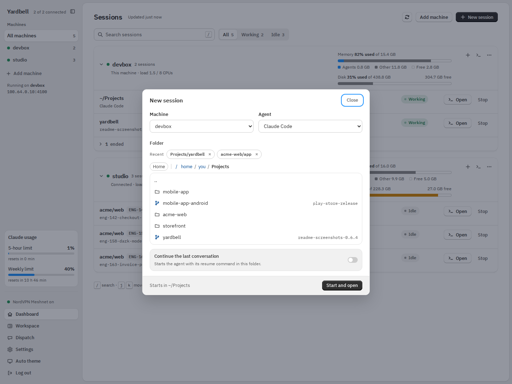
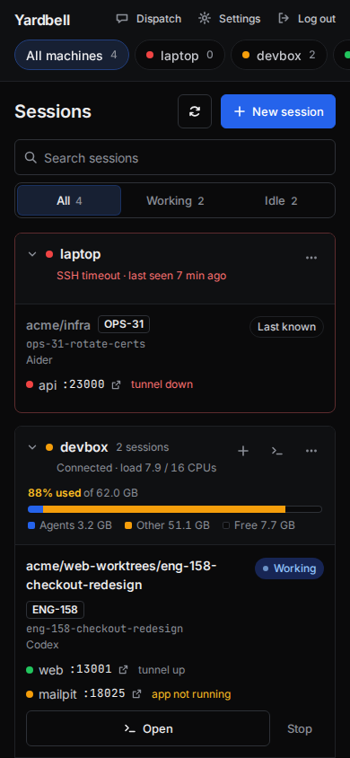
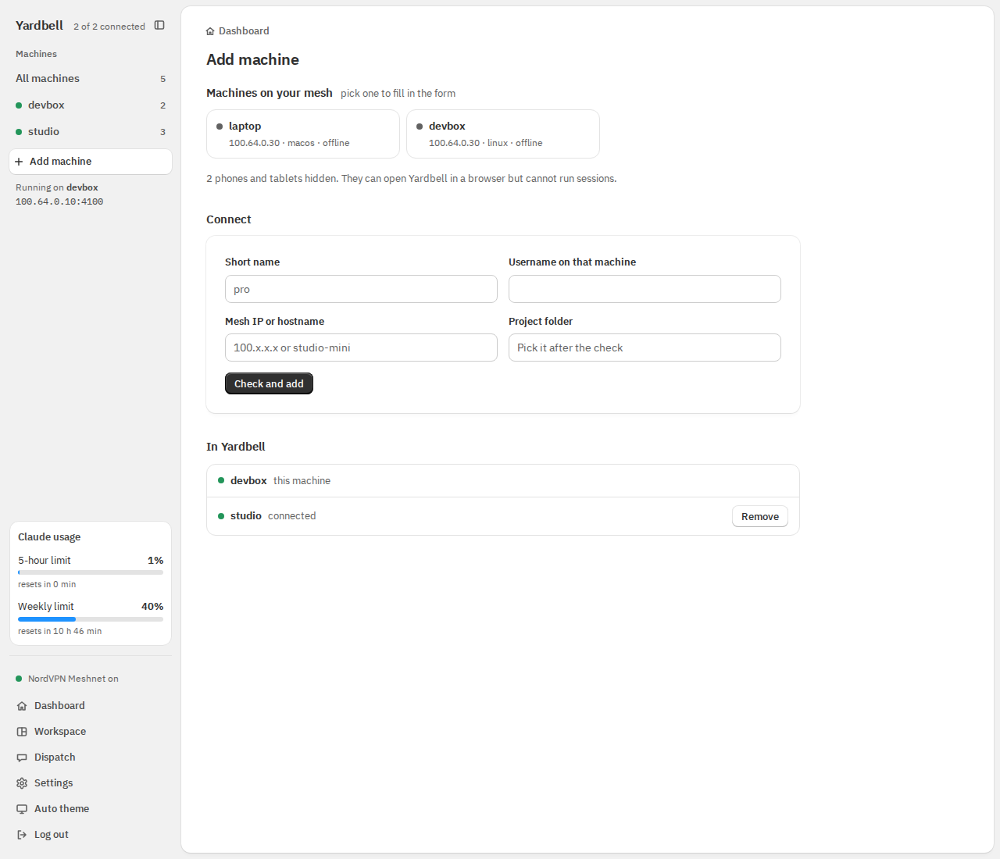
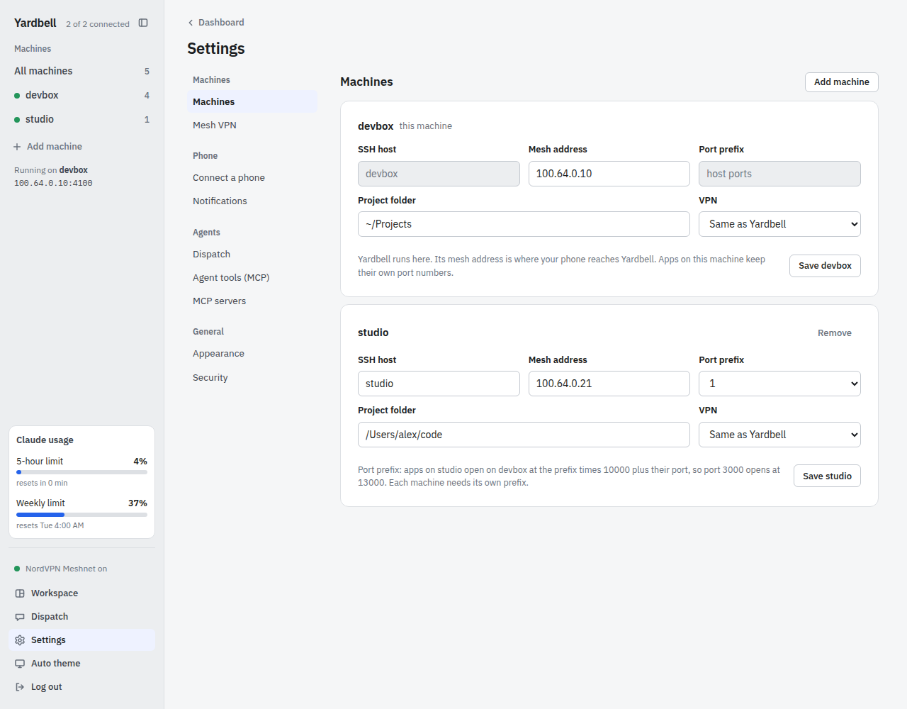
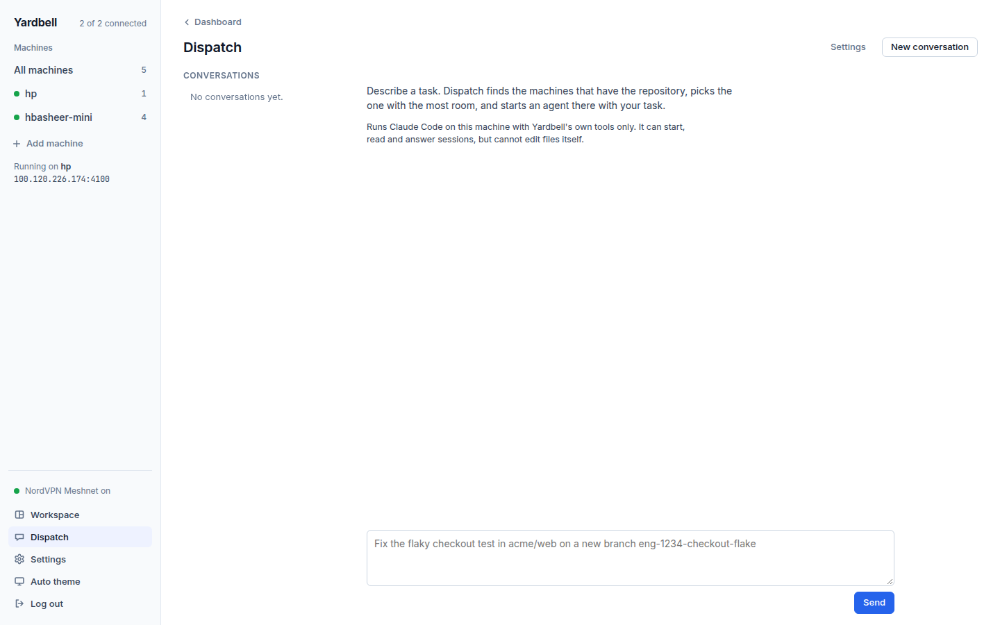

# Using Yardbell

A tour of the pages: dashboard, new sessions, Workspace, the terminal, adding machines, Settings and Dispatch.

## Using Yardbell

### Dashboard

The page is grouped by machine. Each machine gets a section: its health on top (connection, load,
memory drawn to scale with the agents' share in blue, amber from 85% and red from 95%), its sessions
below. The sidebar lists the machines, problems first, with a session count; click one to show only
that machine.

- **Top bar:** search sessions by folder, branch, ticket or agent (press `/`), show All, Working or
  Idle sessions (an agent waiting for you shows **Needs you** and counts as idle), **Refresh** to check every machine right away, Add machine and New session.
- **Machine header:** fold the section away, **+** starts a new session on that machine, the terminal
  button opens a plain shell there (no agent, in its own tmux session), and the **⋯** menu has
  Machine settings, Copy ssh command and Remove machine.
- **Sessions** show folder, ticket, branch, agent, status and ports. Click a row (or press `Enter`) to
  open its terminal, use `j` and `k` to move, and `n` to start a new session. On a phone, a card
  opens only with its **Open** button, so Stop and the other buttons are easy to hit.

Sessions started outside tmux, and sessions that ended, fold into the footer of their machine's
section, since Yardbell can see them but cannot attach to them. Open the list and press **Move to
tmux** on one: Yardbell stops that agent (it asks first) and starts it again in tmux with its resume
command, so the conversation continues, then opens its terminal. The terminal it ran in before gets
its prompt back.

### New session

1. Pick a machine and an agent. The list holds the agents installed on that machine, and the one you
   used last is preselected. **Other agent…** shows the rest, marked as not found there, and
   **Add an agent…** saves a new one by its name and command.
2. Pick a folder from **Recent** or browse the machine. Git repositories show their branch.
3. For a git repository, stay on the current branch, pick another branch, or create a new one from
   a base. Any branch other than the current one opens in its own worktree at
   `<repo>-worktrees/<branch>`; an existing worktree for that branch is reused.

The footer always says where the session will start. Yardbell starts the agent inside a new tmux
session through your login shell, so your PATH and environment apply, then opens its terminal.
**Continue the last conversation** and **Resume** on an ended session use the agent's own resume
command, listed below. Starting an agent in a folder that already has a session starts a second
one, named like the first with `-2` after it.

### Workspace

The **Workspace** page shows terminals side by side. Its sidebar lists every terminal as a tree:
machine, then folder (a workspace), then the sessions in it, each with its state. Click a workspace
to switch to it and a session to open it in the focused pane. Hover a session for its **⋯** menu,
which opens it to the right of or below the focused pane, or in a new tab. Each workspace has tabs: **+** opens the New
session dialog in that folder and the new session in a tab of its own, and closing a tab with
sessions in it asks whether to stop them or keep them running. Double-click a tab to rename it, or
right-click it for Rename tab and Close tab. An empty pane offers to start an
agent there or to open one of the workspace's sessions. Panes split right or down and resize by
dragging the border between them; **Keyboard shortcuts** in the sidebar lists the keys. On a phone
the sidebar comes first and a session opens full screen.

### Terminal and phone

Turn on the mesh VPN on your phone and open `http://<host-mesh-ip>:4000`. Everything works the same,
including the terminal. Several devices can attach to one session. The one you are using sets the
session's size: opening it, clicking in it or typing takes over, and a tab you cannot see or a
phone in the background never does.

On a phone the machines stay on top, sessions become cards, and the terminal gets a key row for Esc,
Tab, Ctrl, the arrows and Ctrl-C. Yardbell follows the system light or dark setting, or the theme
you pick with the button in the sidebar, on each device.

 

**Copying from the terminal.**

- **Drag to select.** With tmux mouse mode on (`set -g mouse on`), tmux makes the selection and
  sends it to your clipboard when you let go. Yardbell asks tmux to do this for its terminal.
- **Shift-drag** (Option-drag on a Mac) selects in the browser instead, and copies when you let go.
- **Copy text** in the header shows the screen as plain text. Select any part of it, or press
  **Copy all**. On a phone, this is the way to copy.

Browsers only allow automatic clipboard access on `https` pages or `localhost`. Over
`http://<host-mesh-ip>` Yardbell copies straight away when it can. If the browser blocks it, a
**Copy** button appears for a few seconds; tap it to finish copying.

### Add machine

Pick a peer from your mesh (phones and tablets are hidden) or type an IP or hostname, then enter the
username and a short name. Yardbell checks each step and stops with the reason when one fails:
reachable, ssh key login, the `~/.ssh/config` entry (shown before it is written, backed up first,
never overwriting an existing `Host`) and installed tools. Then it lists that machine's folders,
starting from the usual project folder when it finds one: click through to the folder that holds
your projects and press **Use this folder and save**. The new machine gets a port prefix, and the
last step says which port its apps open at on the host.

### Settings

Settings shows one section at a time; pick it from the section list (a row of buttons on a phone).

- **Machines:** edit ssh host, mesh address, port prefix, project folder and VPN override, or remove
  a machine. Each remote machine says what its port prefix means in real ports, for example port
  3000 opening on the host at 13000, see [Ports](running.md#ports).
- **Mesh VPN:** choose a provider and press **Check addresses**. Yardbell reads the new VPN's peer list
  and proposes each machine's new address. **Switch VPN** saves `yardbell.yml` and updates the matching
  `HostName` lines in `~/.ssh/config`, with backups of both. If the host's own address changes,
  restart Yardbell (a button does it when Yardbell runs as a service).
- **Connect a phone:** shows a pairing code for the Android app.
- **Notifications:** which notifications the Android app shows, and whether it is connected, see
  [Phone notifications](apps.md#phone-notifications).
- **Dispatch:** your own instructions for Dispatch, the agent it starts and the model it runs on,
  see [Dispatch](#dispatch).
- **Agent tools (MCP)** and **MCP servers:** turn on Yardbell's MCP server and list other MCP
  servers for the sessions it starts, see [Agent tools (MCP)](agents.md#agent-tools-mcp).
- **Appearance:** same as the device, light or dark, like the theme button in the sidebar.
- **Security:** change the passcode (takes effect immediately) and log out every other device.
- **Undo** restores the previous `yardbell.yml` and `~/.ssh/config` after any change.

### Dispatch

The **Dispatch** page takes a task in plain words, like "fix the flaky checkout test in acme/web on a
new branch eng-1234-checkout-flake". It runs Claude Code on the host (`claude -p`) with only
Yardbell's own tools, so it can look at machines, folders and sessions and start, read and answer
sessions, but cannot change files itself. It picks a machine that is up and has the repository,
preferring the most free memory, the lowest load and the fewest running agents, then starts the
default agent there with your task and links to the new session's terminal. Follow-up messages
continue the same conversation, for example "what is that session doing now?" or "tell it yes".
Every conversation is kept in a list beside the chat, also after a restart, so you can go back to
one or delete it; **Clear all** deletes every conversation that is not still working. Deleting a
conversation never stops the sessions it started. Claude Code must be installed and signed in on
the host.

The **Dispatch** section of Settings adds your own instructions to its prompt (where your
repositories live, which machine suits which work, how you name branches), picks the agent it
starts in new sessions from the ones installed on your machines, and picks the Claude model that
runs Dispatch itself; Haiku is the fastest.
